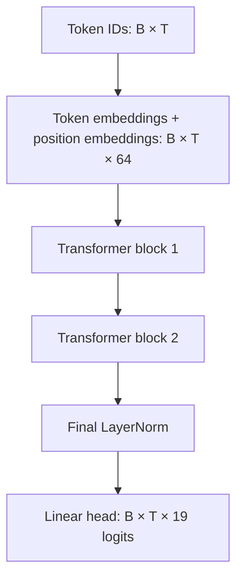
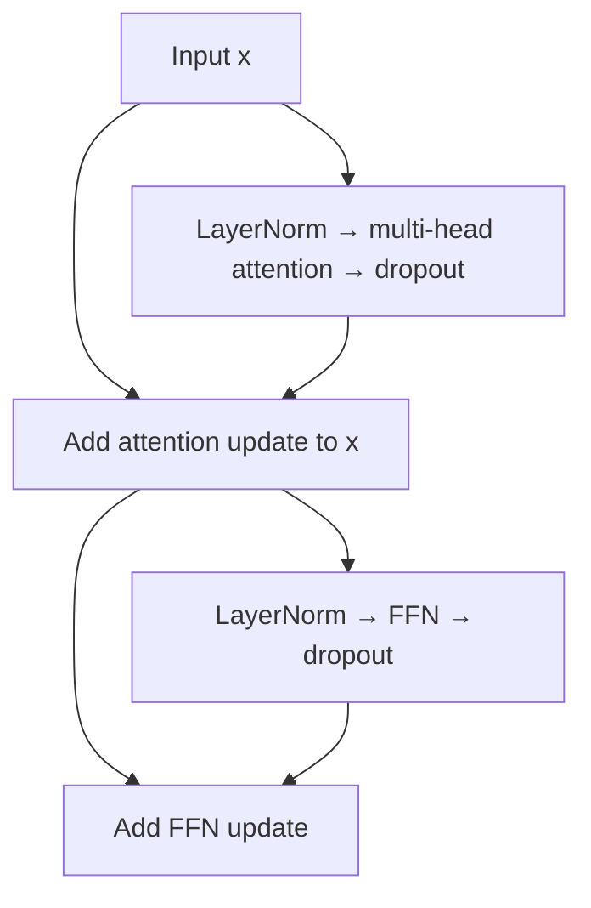

# Transformer Architecture: From Tokens to Answers

A practical guide to the educational `model.py` used in this project.
The explanations use the instruction vocabulary (19 tokens), D=64, four attention
heads, two Transformer blocks, and a feed-forward width of 256.
The original model file used a default vocabulary of 13; instruction training
must explicitly construct the model with `vocab=19`.

## 1. The whole model in one view

The model receives a sequence of token IDs and produces a score for every possible
next token at every input position.



At generation time, take the LAST position's logits, choose the next token, append
it to the input, and run the model again. At training time, calculate loss at all
supervised answer positions in parallel, using a causal mask.

This is a **decoder-only, pre-LayerNorm Transformer**. It has neither a separate
encoder nor cross-attention. The original 2017 Transformer had an encoder-decoder
architecture; our model is a smaller educational variant, not an exact replica.

## 2. The running example: 77 - 51

The prompt is:

```text
BOS SUB 7 7 SEP 5 1 SEP
10  17  7 7 11  5 1 11
```

The desired continuation is `2 6 EOS`. At the initial generation call:

- B=1: one example;
- T=8: eight prompt tokens;
- D=64: a 64-component vector at each position;
- V=19: possible output token classes;
- H=4: four heads, each of dimension d_h=16.

A position is not the same thing as a token class. There are two occurrences of 7,
and three occurrences of the separator/other special tokens in this example's
structure. Repeated tokens start with the same token embedding but receive
different positional embeddings and can acquire different contextual representations.

The model is not supplied a subtraction routine. SUB is a learned categorical
embedding. If the model succeeds, its parameters implement a useful mapping from
this instruction and these operand digits to the next answer token.

## 3. Token embeddings: replace IDs with learned vectors

Code:

```python
self.token = nn.Embedding(vocab, dim)
x = self.token(ids)
```

With V=19 and D=64, the embedding table has shape [19,64]. Token ID 7 selects row 7;
SUB selects row 17. The output changes from [B,T] integer IDs to [B,T,64] floating
point vectors.

Intuition: each symbol receives a learned description that later layers can use.
The coordinates are not manually named properties such as “digit value,” “tens,”
or “operation type.” Useful features may be distributed across many coordinates.

ID 17 is not numerically larger than ID 7 in a meaningful model sense. The network
looks up different rows; it does not receive 17 as the scalar operand seventeen.
The two 7s share a token embedding because they belong to the same symbol class.

These embeddings begin randomly and are updated by gradients. Token frequency,
context and task loss influence what they learn. There is no pretrained semantic
knowledge in this model.

## 4. Position embeddings: distinguish where tokens occur

Code:

```python
self.position = nn.Embedding(max_len, dim)
x = x + self.position(torch.arange(t, device=ids.device))
```

Position 0 has one learned vector, position 1 another, and so on up to the context
capacity of 64. Broadcasting applies the same position table to every batch example.
The result still has shape [B,T,64].

Intuition: the token embedding says “which symbol”; the positional embedding adds
“where in this sequence.” Thus the two 7s can be distinguished despite sharing
one token embedding. Separators and context allow learned positional patterns to
relate to operand structure, although an absolute position is not automatically
a decimal place or a position relative to SEP.

Addition, rather than concatenation, keeps the vector width fixed. This does not
reserve distinct named coordinates for symbols and positions: later transformations
learn to use the combined signal.

Our positions are learned and absolute. RoPE and sinusoidal encodings are not
implemented. Unseen positions have no guarantee of useful training, so working on
six-digit sequences does not establish transfer to much longer ones. Also, the
causal visibility structure itself supplies some order information: removing
positional embeddings does not mathematically guarantee total failure.

## 5. A Transformer block has two main sublayers

The exact order in `Block.forward()` is:

```python
a, weights = self.attn(self.ln1(x))
x = x + self.drop(a)
x = x + self.drop(self.ffn(self.ln2(x)))
return x, weights
```



Attention mixes information BETWEEN positions. The FFN transforms features WITHIN
each position. Residual connections carry the running representation around both
sublayers. LayerNorm controls its local feature scale.

Both blocks have this structure, but separate parameters. The same block parameters
are shared across positions and examples, not shared between block 1 and block 2.

## 6. LayerNorm: normalize a position's feature vector

For one vector x of width D:

`LN(x)_j = gamma_j * (x_j - mean(x)) / sqrt(var(x) + epsilon) + beta_j`

The mean and variance are calculated across the D feature components of that
position, not across the batch or all sequence positions. The scale gamma and
shift beta are learned. Epsilon prevents division by zero.

Intuition: before processing a position's description, put its feature magnitudes
on a controlled scale, then allow learned rescaling. This helps optimization but
does not make every position semantically equivalent.

Pre-LN means normalization happens BEFORE attention and BEFORE the FFN. The main
residual stream itself is not overwritten by its normalized version: sublayers
receive LN(x), and their outputs are added back to x. This supports gradient flow
through the residual path. There is also a final LayerNorm before classification.

## 7. Q, K and V: three views of the current representation

Code:

```python
self.qkv = nn.Linear(dim, 3 * dim)
q, k, v = self.qkv(x).chunk(3, dim=-1)
```

The normalized representation produces three learned projections. With D=64, the
combined layer maps 64 features to 192, then splits that into three sets of 64.
It is equivalent to three distinct affine maps, packaged as one operation.

A useful analogy:

| Projection | Intuitive role |
|---|---|
| Query Q at position i | What information does this position seek? |
| Key K at position j | What can make this position relevant to a query? |
| Value V at position j | What information is transferred if it is attended to? |

These are roles in the computation, not literal database keys or human-written
questions. Their meaning emerges from training. Q/K/V are computed for every
input, while their projection matrices are learned parameters.

At the final SEP position, a successful model may gather information about SUB,
the operand digits, and separators. It is not guaranteed that one specific head
has a clean human-readable “subtraction” role.

After splitting into four heads, each Q/K/V tensor has shape [B,4,T,16]. Each head
operates in its own learned projection subspace.

## 8. Attention scores: decide where information can come from

For head h, query position i and key position j:

`s_ij = dot(q_i, k_j) / sqrt(d_h)`

Code:

```python
scores = q @ k.transpose(-2, -1) / math.sqrt(self.dk)
```

For the initial eight-token prompt, scores have shape [1,4,8,8]. Each head has an
8-by-8 table: a row is a query position, a column is a candidate source position.
The dot product is a learned compatibility score, not necessarily geometric or
linguistic similarity in the ordinary sense.

Scaling by sqrt(d_h) helps control dot-product magnitudes as head width increases,
reducing the tendency for softmax to saturate simply because vectors are wider.
In this model sqrt(16)=4.

### Causal masking

```python
forbidden = torch.ones(t, t, dtype=torch.bool, device=x.device).triu(1)
scores = scores.masked_fill(forbidden, float('-inf'))
```

For query i, all j>i are forbidden. Self-attention to j=i is allowed.
The mask is a rule, not a learned parameter.

During training on `prompt 2 6`, the final SEP must predict 2 without looking at
the 2 and 6 already present later in the training input. Masking enforces this
restriction at EVERY block. Merely ignoring future positions in the loss would
not prevent information leakage through attention.

### Softmax

```python
weights = scores.softmax(dim=-1)
```

`A_ij = exp(s_ij) / sum_allowed_j exp(s_ij)`

Each row sums to one and forbidden entries are zero. If one row assigns 0.4 to
one position, that means a mixing coefficient of 0.4 for that head/query. It is
not a 40% probability that the input token is “the correct answer.”

## 9. Weighted values: actually transfer information

Code:

```python
mixed = weights @ v
```

For query position i:

`u_i = sum_j A_ij * v_j`

An illustrative, invented row might put 0.4 on a source digit, 0.3 on another
source digit, 0.2 on the operation, and 0.1 on a separator. The output is the
corresponding weighted sum of their VALUE VECTORS, not a weighted sum of literal
digits. These weights are an explanation example, not measured values from your
checkpoint.

This distinction matters: attention need not select exactly one position, and
its values can carry transformed features rather than raw symbols. In later
blocks each value may already encode context collected by earlier blocks.

Heads are concatenated back into width 64 and passed through an output projection:

```python
mixed = mixed.transpose(1, 2).contiguous().reshape(b, t, d)
output = self.out(mixed)
```

The output projection combines features contributed by different heads. The full
attention sublayer maps [B,T,64] to [B,T,64]. Four heads do not mean four independent
models voting on a final answer.

## 10. Residual connections and dropout

After attention:

```python
x = x + self.drop(a)
```

Intuition: keep the existing description and add an update, rather than replacing
it completely. Matching dimensions make the addition possible. The identity path
also gives gradients a route that bypasses a sublayer; it helps train deeper models
without guaranteeing stable optimization in every situation.

Dropout randomly zeros feature entries during training and scales retained entries
by 1/(1-p). At evaluation it is disabled. It discourages dependence on particular
activations and can regularize learning. It does not intentionally delete input
characters or alter targets.

In this implementation dropout is applied to attention OUTPUT and FFN OUTPUT,
not to the attention probabilities themselves. Two calls to the same Dropout
module generate separate random masks in training.

## 11. The FFN: transform the collected features

Code:

```python
self.ffn = nn.Sequential(
    nn.Linear(dim, 4 * dim),
    nn.GELU(),
    nn.Linear(4 * dim, dim),
)
```

With D=64, this is 64 → 256 → 64. The first linear map expands the feature space,
GELU applies a nonlinear transformation, and the second maps back to the residual
width. Bias terms are present in these linear layers.

The same FFN is applied independently at each position. It does not directly read
other positions; it transforms information that attention has already collected.
Nonlinearity matters: without it, two consecutive affine maps could collapse into
one affine map, losing this source of expressive power.

Intuition: attention gathers relevant evidence; the FFN processes combinations
of that evidence. This is not a guaranteed division into “attention retrieves
operands, FFN executes subtraction.” Computation is distributed and can use both
sublayers across multiple blocks.

The FFN output is dropped out and added through the second residual connection.
All intermediate contextual representations still have width 64 after each block.

## 12. Why stack blocks? What do block 1 and block 2 do?

Block 1 attends over representations built from symbols and positions. Block 2
attends over contextual representations produced by block 1. It can therefore
combine information whose dependencies were assembled earlier.

A plausible learning pattern is that earlier computation helps distinguish operand
fields, while later computation combines instruction and digit relationships.
But this is a hypothesis, not a guaranteed layer assignment. We cannot assert
“layer 1 parses numbers; layer 2 subtracts” from the architecture or a successful
answer. Nor does a two-block model necessarily execute the familiar handwritten
arithmetic algorithm.

To investigate specialization, compare head/layer activations, mask or ablate
components, and measure changes on controlled examples. Attention plots alone
show routing coefficients, not a complete causal explanation. High attention to
a token does not by itself establish that it determined the output.

## 13. Final LayerNorm and output head

Code:

```python
return self.head(self.norm(x)), maps
```

The final normalized representation at every position is mapped from 64 features
to 19 logits. The head has shape [19,64] in PyTorch's weight storage plus 19 biases.
Its output has shape [B,T,19].

At the last prompt SEP, the model might assign the largest logit to token 2.
That would predict the first answer digit. It does not simultaneously emit the
entire integer 26 as one class.

Training passes raw logits to CrossEntropyLoss, which incorporates log-softmax.
Greedy generation uses argmax directly; softmax is unnecessary when only the
largest score is needed because it preserves score ordering.

All 19 classes remain possible in this implementation. It has no special output
constraint forbidding SUB or BOS in an answer. Training is expected to suppress
inappropriate classes; a malformed generated token is still possible.

## 14. The three generation passes for 26 EOS

| Forward pass | Input | Desired prediction from final position |
|---|---|---|
| 1 | `BOS SUB 7 7 SEP 5 1 SEP` | 2 |
| 2 | `BOS SUB 7 7 SEP 5 1 SEP 2` | 6 |
| 3 | `BOS SUB 7 7 SEP 5 1 SEP 2 6` | EOS |

Every pass runs embeddings, both blocks, final normalization and the head.
The model recomputes the prefix; there is no KV cache. The program stops on EOS
or a generation limit. If it predicts a wrong digit, that wrong digit becomes
part of the next pass's context.

The actual arithmetic result used as `Expected` by inspect_model.py is computed
outside the network for comparison. It is not passed to free-running generation.
Attention visualization uses the reference answer under teacher forcing, so its
input differs from the model's own trajectory when generation goes wrong.

## 15. Training: the same layers, with gradient computation

For this example, teacher-forced input is:

```text
BOS SUB 7 7 SEP 5 1 SEP 2 6
```

The three supervised targets are 2 after SEP, 6 after 2, and EOS after 6.
All positions are calculated in one forward pass. Causal masks enforce the same
prefix visibility as generation even though the full reference input is present.

Cross entropy compares logits with next-token labels. Backpropagation differentiates
that loss through the head, final LayerNorm, both blocks, and embeddings. AdamW
updates learned parameters. Clipping limits global gradient norm before the update.

Attention matrices are input-dependent intermediate results, not persistent model
parameters. Their gradients help update Q/K/V projections, which change attention
on later passes. The masks and token IDs are not learned by gradient descent.

Teacher forcing, the loss, and AdamW are training choices around the architecture.
They are not additional layers in the model's forward computation.

## 16. Shapes at a glance

| Component | Input | Output |
|---|---|---|
| Token embedding | B × T | B × T × 64 |
| Add position embedding | B × T × 64 | B × T × 64 |
| LayerNorm | B × T × 64 | B × T × 64 |
| Combined QKV projection | B × T × 64 | B × T × 192 |
| Split Q, K, V into heads | Three B × T × 64 tensors | Three B × 4 × T × 16 tensors |
| QK-transpose scores | Q and K | B × 4 × T × T |
| Mask and softmax | B × 4 × T × T | B × 4 × T × T |
| Attention × V | Weights and V | B × 4 × T × 16 |
| Merge heads and project | B × 4 × T × 16 | B × T × 64 |
| FFN expansion | B × T × 64 | B × T × 256 |
| GELU | B × T × 256 | B × T × 256 |
| FFN contraction | B × T × 256 | B × T × 64 |
| Output head after final norm | B × T × 64 | B × T × 19 |

B is the number of examples; T can include right-padding in a batch. Targets at
padded positions are ignored. Because this model is causal and padding is on the
right, later padding does not affect earlier real positions. This argument would
not automatically hold for bidirectional attention.

## 17. Parameter counts in the instruction model

For vocab=19, dim=64, heads=4, layers=2, max_len=64:

| Component | Trainable parameters |
|---|---:|
| Token embeddings | 19 × 64 = 1,216 |
| Position embeddings | 64 × 64 = 4,096 |
| QKV projection, per block | 64 × 192 + 192 = 12,480 |
| Attention output projection, per block | 64 × 64 + 64 = 4,160 |
| Two LayerNorms, per block | 2 × (64 + 64) = 256 |
| FFN, per block | (64 × 256 + 256) + (256 × 64 + 64) = 33,088 |
| Total per block | 49,984 |
| Two blocks | 99,968 |
| Final LayerNorm | 128 |
| Output head | 64 × 19 + 19 = 1,235 |
| **Total** | **106,643** |

With fixed D, changing the number of heads changes the subspace partition rather
than these linear layer parameter counts. D must be divisible by H. Increasing
D increases the dominant matrix sizes approximately quadratically; adding blocks
increases their parameter count linearly. Parameter count is not the number of
training examples or a guarantee of algorithmic generalization.

## 18. Architecture boundaries and comparisons

| Architecture | Main context mechanism | Typical relevant use |
|---|---|---|
| RNN | Repeated state update across positions | Sequential modeling |
| LSTM | Recurrent hidden state plus gated cell state | Sequential modeling with a controlled memory path |
| Encoder-only Transformer | Usually bidirectional self-attention | Contextual representations, classification, segmentation |
| Decoder-only Transformer | Causal self-attention | Next-token generation, including our instruction model |
| Encoder-decoder Transformer | Encoder self-attention plus decoder causal attention and cross-attention | Conditional sequence generation, such as translation |

A decoder-only model's prompt is not a separate encoder. Cross-attention would
use queries from one representation stream and keys/values from another; our
attention uses one stream to build all three.

Full self-attention uses a quadratic number of position pairs as T grows. Our
explicit implementation also materializes those attention maps. Parallel teacher-
forced training does not remove the sequential dependence between generated tokens.

## 19. Read the code in this order

1. `Transformer.forward`: follow shapes and the block loop.
2. `Block.forward`: locate normalization, residual additions and dropout.
3. `Attention.forward`: inspect Q/K/V reshaping, masking and weighted mixing.
4. `train_step`: connect predictions to loss, gradients and parameter updates.
5. `generate_answer`: see how the same model is reused for each next token.
6. `inspect_model.py`: distinguish reference-context attention maps from actual generation.

Try comparing the SAME digits under REVERSE and SORT. Change one operand while
keeping the operation fixed. Compare heads, then verify output behavior. Do not
assign semantic names to heads solely because a heatmap looks plausible.

The most useful intuitive summary of one block is: normalize a position's current
representation, exchange information through attention, add that update, normalize
again, transform the collected features with an FFN, and add that update. Repeat
with new learned parameters, then classify the next token.

Further reading: [Attention Is All You Need](https://arxiv.org/abs/1706.03762).
For dataset alignment and loss details, see DATASET_GUIDE.md and TRAINING_METRICS.md.
