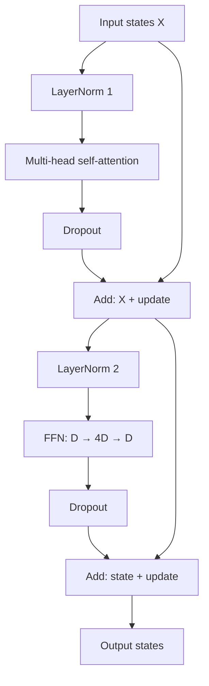

# Transformer components and data flow

This guide explains the standard dense Transformer family and maps its parts to
our educational `model.py`. Documentation is in English for the repository.
The concrete code mapping was checked against the dot-product steps lab.
Other experiments may wrap or extend these components.

## 1. Three architecture families

A Transformer is built from attention, position-wise feed-forward networks,
normalization and residual connections. The word does not imply one fixed
input/output layout.

| Family | Information available to a position | Typical use |
|---|---|---|
| Encoder-only | All unmasked input positions | Classification, sequence representations, token labeling |
| Decoder-only | Current and earlier positions under a causal mask | Autoregressive generation; our standard arithmetic labs |
| Encoder–decoder | Encoder reads source; decoder reads earlier output and attends to encoder states | Translation and other sequence-to-sequence tasks |

The original Transformer used an encoder stack and a decoder stack. Our standard
model is a causal decoder-only variant: prompt and answer form one sequence.
It has no separate encoder and no cross-attention. The term decoder-only here
means the common causal language-model architecture, not an original decoder
with its cross-attention left enabled.

## 2. Components at a glance

| Component | Purpose | What it receives and returns |
|---|---|---|
| Tokenizer / serializer | Turn data into discrete symbols | Text or structured data → token IDs |
| Token embedding | Learn a vector for each token identity | IDs → one D-dimensional vector per position |
| Position information | Make sequence order available | Position index or relative relation → modification of representations/attention |
| Self-attention | Exchange information between permitted positions | Sequence vectors → context-dependent sequence vectors |
| Attention mask | Define permitted information flow | Forbidden score entries → negative infinity before softmax |
| Multi-head organization | Learn several parallel attention projections | D channels → H heads → D channels |
| Attention output projection | Combine the head outputs | Concatenated heads → D channels |
| Feed-forward network (FFN / MLP) | Apply a learned nonlinear transformation at each position | D → wider hidden space → D |
| Residual addition | Preserve a direct path while learning updates | Old state + computed update → new state |
| Layer normalization | Normalize features and learn their scale/offset | Each position's D features → normalized D features |
| Dropout | Regularize training by randomly dropping/scaling activations | Activations → stochastic training activations; identity at evaluation |
| Final normalization | Normalize the stack output in our pre-LN model | Final sequence states → normalized states |
| Output head | Convert hidden features to task scores | D features → vocabulary logits, or other task outputs |
| Output selection | Choose generated tokens | Logits → greedy choice or sampled token |
| Loss and optimizer | Train all participating parameters | Predictions + labels → gradients → parameter updates |

Tokenization and output selection are pipeline components, not necessarily
`nn.Module` layers. Loss and optimizer belong to training, not the inference
stack. Classification need not use a generative vocabulary head.

## 3. Two levels of architecture

The diagram shows the internal branching of one block in **our pre-LN model**.
The whole model adds token/position embeddings before a stack of these blocks,
and final LayerNorm plus vocabulary projection after it.



Each block preserves sequence length and channel width. Stacking four or eight
blocks repeats this computation with independently learned parameters; it does
not prescribe four or eight mathematical operations.

## 4. Notation and tensor shapes

Let B = batch size, T = token sequence length, V = vocabulary size,
D = model width, H = number of attention heads, and d_k = D/H in our code.
D must be divisible by H. V also denotes a value tensor in attention literature;
use the surrounding context to distinguish it from vocabulary size.

| Quantity | Shape in our implementation |
|---|---|
| Token IDs | B × T |
| Token embedding table | vocabulary_size × D |
| Position embedding table | max_len × D |
| States entering/leaving each block | B × T × D |
| Combined QKV projection | B × T × 3D |
| Q, K, value tensors after splitting heads | B × H × T × d_k each |
| Attention scores and weights | B × H × T × T |
| Concatenated head outputs | B × T × D |
| FFN hidden activations | B × T × 4D |
| Vocabulary logits | B × T × vocabulary_size |

For D64, H4, each head has width16 and the FFN hidden width is256.
These are feature dimensions, not 64 independent mathematical specialists.
A head is not a neuron: it contains learned projections and a dynamic attention
matrix. The FFN's256 hidden units are shared across token positions within a block.

## 5. Embeddings: identities and positions

```python
self.token = nn.Embedding(vocab, dim)
self.position = nn.Embedding(max_len, dim)
```

Initialization creates parameter tables with initially random values. A forward
pass performs the lookup:

```python
x = self.token(ids)
x = x + self.position(torch.arange(t, device=ids.device))
```

Token ID20 is a table index, not numerical magnitude20. Decimal digits become
mathematical numbers only through the task representation and learned behavior.
Position vectors have width D and are broadcast across the batch.

Without position information, ordinary unmasked self-attention is permutation
equivariant: permuting input positions permutes its outputs. A causal mask itself
introduces an ordering constraint, but does not replace a useful positional
representation. Position information is important for digit places, vector
component alignment and syntax.

Our code learns absolute position embeddings. Other designs use fixed sinusoidal
encodings, relative position mechanisms or rotary position information; those
are alternatives, not extra components present in this model. A learned table
with max_len192 does not establish reliable generalization to longer sequences
than those seen during training.

## 6. Self-attention, step by step

### 6.1 Produce Q, K and values

```python
self.qkv = nn.Linear(dim, 3 * dim)
q, k, v = self.qkv(x).chunk(3, dim=-1)
```

This single linear layer is equivalent to three learned affine projections.
Conceptually, a query asks what information a position needs; a key describes
what a position can match; a value supplies the information to mix. These are
intuition aids, not human-assigned semantic labels.

For one head, omitting batch dimensions:

Q = XW_Q + b_Q, K = XW_K + b_K, values = XW_V + b_V.

### 6.2 Compute compatibility and mask it

For query position i and key position j:

$$s_{ij}=q_i^T k_j/\sqrt{d_k}.$$

The scale controls growth of score magnitudes as the dot-product dimension
increases, helping avoid overly saturated softmax at initialization.

A causal mask sets scores for j > i to negative infinity. Position i can attend
to itself and previous positions, but cannot read future answer tokens.
A padding mask serves a different purpose: hiding padding positions. Our basic
right-padded, causal training setup ignores padded labels and needs no extra
padding-key mask for valid earlier positions: right padding is in their future.
This assumption must be revisited for left padding or bidirectional attention.

### 6.3 Normalize scores and mix information

$$A_{ij}=\frac{\exp(s_{ij})}{\sum_{k\ \mathrm{allowed}}\exp(s_{ik})},
\qquad z_i=\sum_j A_{ij}v_j.$$

Each query's allowed attention weights sum to1. A[i,j] measures how much value
information flows from key position j into query position i for that head.
Attention weights are recomputed for each input; they are not persistent learned
parameters. QKV projection matrices are persistent learned parameters.
An attention map is useful for inspection but is not a proof of causal
explanation or an explicit record of an arithmetic algorithm.

### 6.4 Combine heads

Each head uses its own projected features. Our implementation obtains them by
splitting the projected D channels into H pieces. Outputs are concatenated and
passed through `self.out = nn.Linear(dim, dim)`.

Heads operate in parallel within a block. Blocks operate sequentially. There is
no guarantee one head learns multiplication while another learns addition.

## 7. FFN: local nonlinear computation

```python
self.ffn = nn.Sequential(
    nn.Linear(dim, 4 * dim),
    nn.GELU(),
    nn.Linear(4 * dim, dim),
)
```

Attention mixes information **between positions**. The FFN transforms features
**within each position**, using the same weights at every position of that block.
It does not directly access other positions, but its input already includes
context gathered through attention.

GELU adds nonlinearity. Without a nonlinear activation, two consecutive affine
layers would collapse into one affine transformation. The wider intermediate
space provides additional feature-processing capacity; 4D is a design choice.
Other Transformers may use different widths or gated activations.

A Transformer therefore contains FFNs, but is not merely a flattened-input FFN:
its learned, input-dependent attention exchanges information along the sequence.

## 8. Residuals, normalization and dropout

Our exact block equations are:

$$U=X+\operatorname{Dropout}(\operatorname{Attention}(\operatorname{LN}_1(X))),$$
$$Y=U+\operatorname{Dropout}(\operatorname{FFN}(\operatorname{LN}_2(U))).$$

Residual paths let a sublayer learn an update instead of reconstructing the whole
representation, and provide direct gradient paths through a deep stack. They
help optimization; they do not guarantee successful training.

LayerNorm computes mean and variance across a position's feature channels,
then applies learned scale and bias. It is not BatchNorm and does not normalize
one example using other examples in the batch. Normalization helps control
activation behavior, not arithmetic correctness.

This is **pre-LN** because normalization precedes each sublayer. The original
Transformer used post-sublayer normalization in its residual arrangement.
Do not mix the two diagrams when reading implementations.

`model.train()` activates dropout. `model.eval()` disables it. Evaluation mode
alone does not disable gradient tracking; `torch.no_grad()` does that separately.
Our Attention has no separate attention-probability dropout; Block applies
dropout to attention and FFN outputs before residual addition.

## 9. Final head and generation

```python
return self.head(self.norm(x)), maps
```

`self.head = nn.Linear(dim, vocab)` produces unnormalized vocabulary scores
(logits) for each position. These are not token IDs or probabilities.
Our embedding and output matrices are separate parameters, not weight-tied.

For greedy generation we use the last position's logits and choose argmax.
Softmax is unnecessary for argmax because it preserves ordering. Sampling needs
a probability distribution, possibly modified by temperature or token filters.
The attention softmax and output-vocabulary softmax serve different purposes.

The selected token is appended to the prefix. Another forward pass predicts the
next token. Generation ends at EOS or a configured limit. Our simple generator
recomputes the prefix on each step; it has no KV cache. A KV cache reuses past
key/value activations during inference; it is neither a learned database nor
persistent training knowledge.

## 10. What encoder–decoder adds

An encoder block normally has bidirectional self-attention plus an FFN, with
normalization and residuals. Its output represents the source sequence.

An original-style decoder block has three major sublayers:

1. Causal self-attention over output-prefix states.
2. Cross-attention to encoder output.
3. A position-wise FFN.

In cross-attention, queries come from decoder states, while keys and values come
from encoder output. Its attention matrix has output_length × source_length,
not necessarily a square shape. Masking the decoder future is still necessary.
There are normalization/residual paths around these sublayers too.

Our standard arithmetic model instead places operands and generated answer in
one causal stream. During answer generation its self-attention can read earlier
operand tokens directly, so it does not require cross-attention.

## 11. Training: where all the parameters learn

For prompt P and correct answer A:

```python
input_ids = (P + A)[:-1]
labels = [-100] * (len(P) - 1) + A
```

At the final prompt position, the target is the first answer token. At each
subsequent position, the target is the next answer token, including final EOS.
Cross-entropy ignores -100 labels. It accepts logits directly and handles the
log-softmax computation internally; do not softmax logits first.

For valid target positions, mean loss is:

$$L=-\frac{1}{N}\sum_i\log p_\theta(y_i\mid\text{preceding tokens}).$$

`loss.backward()` computes gradients through the head, blocks and embeddings.
`optimizer.step()` updates participating parameters. The optimizer does not
assign semantic duties to particular heads or blocks.

Teacher forcing supplies correct earlier answer tokens during training. Causal
masking prevents reading future answer tokens even though the full shifted
sequence is processed in parallel. At generation time, earlier answer tokens
are the model's own predictions, so errors may propagate.

For scratchpad dot products, products, accumulated sums and final answer are
all supervised output tokens. They do not create separate modules. A modular
pipeline with an enforced typed interface is a different architectural choice.

## 12. Following one prediction through our lab

Input: `[1,2,3]` and `[4,5,6]`.

1. Serializer emits BOS, DOT, vector length/number markers, digits and SEP.
2. Token embeddings look up D-dimensional vectors; position embeddings are added.
3. Each block normalizes states, computes masked multi-head attention, adds its
   update, normalizes again, applies the FFN and adds that update.
4. Final normalization and head produce vocabulary logits.
5. At the last prompt position, trace mode should select PRODUCTS.
6. The generator appends this prediction and repeats until EOS, ideally producing
   products `[4,10,18]`, sums `[4,14,32]` and final answer32.
7. Evaluation separately checks formatting, each generated list, internal
   consistency and final arithmetic correctness.

The model does not execute a multiplication instruction just because it emits
PRODUCTS. Correct arithmetic must be demonstrated empirically.

## 13. Where to find each component in code

| Code | Role |
|---|---|
| `data.py`: prompt/record/encode | Serialization, vocabulary lookup, targets and loss masks |
| `Transformer.__init__`: `self.token`, `self.position` | Create trainable embedding tables |
| `Transformer.__init__`: `self.blocks` | Instantiate independently parameterized blocks |
| `Block.__init__`: `self.attn = Attention(...)` | Instantiate each attention module |
| `Attention.__init__`: `self.qkv`, `self.out` | Create learned attention projections |
| `Attention.forward` | QKV, heads, scores, causal mask, softmax, value mixing |
| `Block.__init__`: `self.ffn` | Create the position-wise MLP |
| `Block.forward` | Wire pre-LN, attention/FFN, dropout and residual additions |
| `Transformer.forward` | Embedding lookup, position addition, block loop, final head |
| `engine.py`: generate | Autoregressive token selection and stopping |
| `train.py`: loss/backward/opt.step | Compute training objective and update parameters |

Initialization creates modules and weights. `forward` defines their actual
interaction for a particular batch. Read both to understand the architecture.
