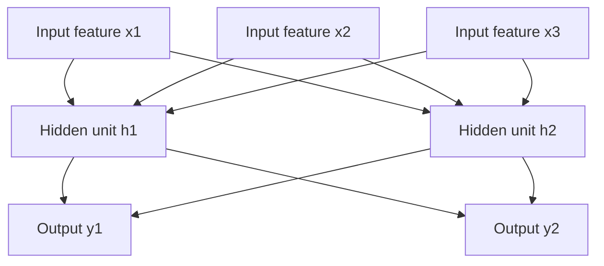
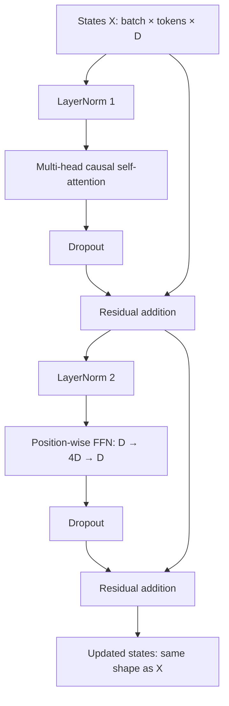
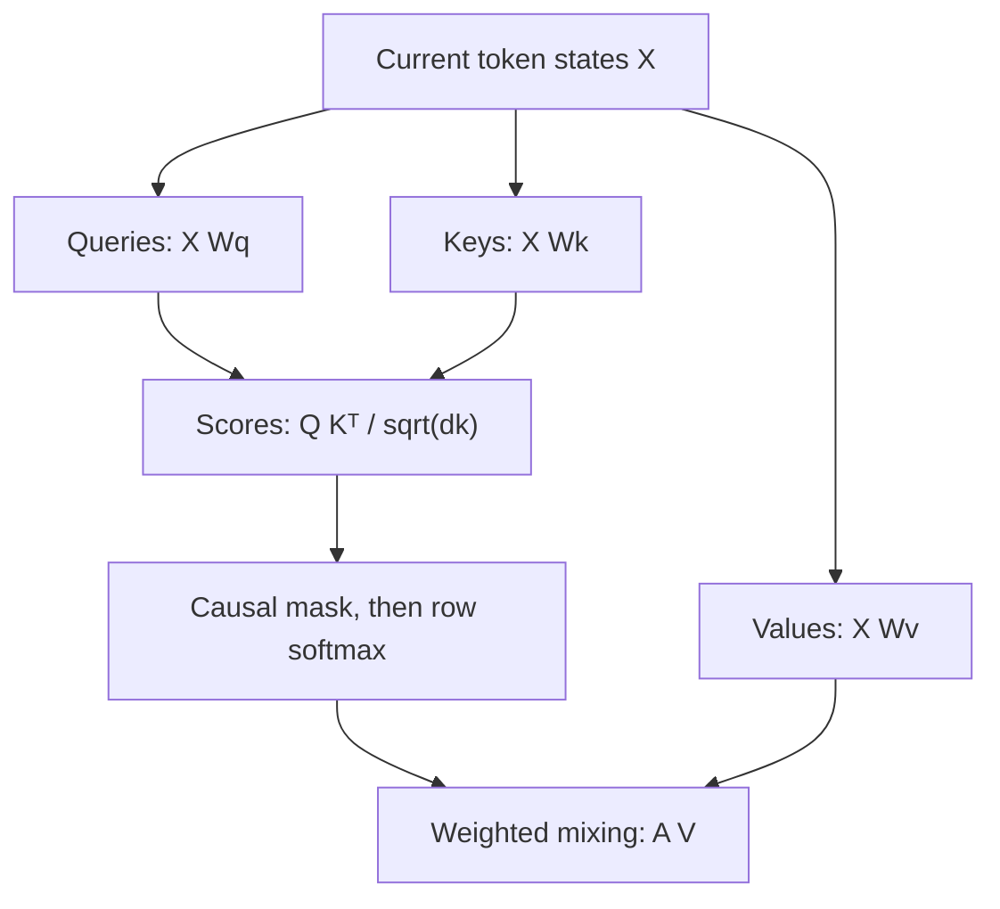
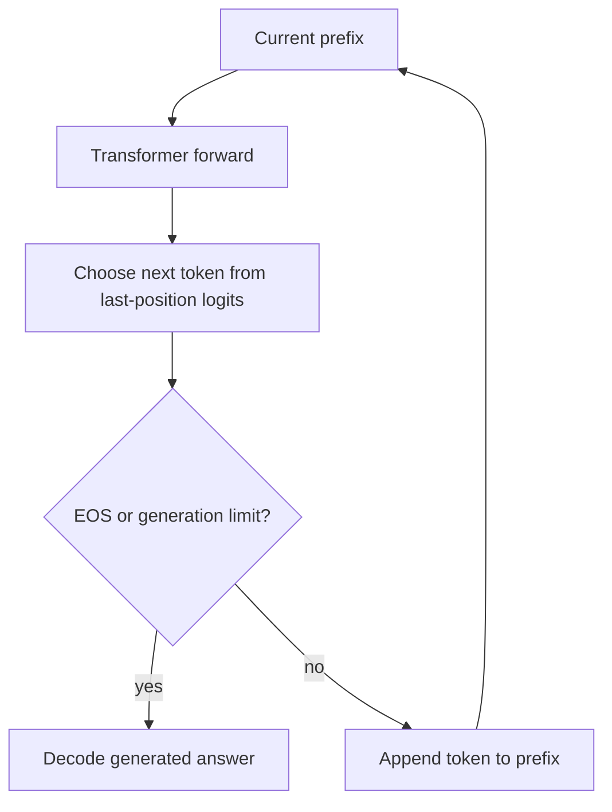

# FFN versus Transformer: architecture, information flow and our experiment

This guide describes the actual models in `architecture_comparison`, then
separates their essential architectural differences from choices of input format,
training loss and decoding. Diagrams use Mermaid, supported by GitHub Markdown.
Node labels represent groups of features or operations, not necessarily individual
neurons, unless explicitly stated.

## 1. The central distinction

Our dense FFN receives the whole flattened input as one fixed-size vector and
mixes its coordinates through learned dense matrices. Our Transformer keeps a
vector per token position and uses attention to mix information **between
positions**, with mixing weights computed from the current input.

Both contain learned affine transformations and nonlinear activations. Both are
trained by backpropagation. A Transformer contains position-wise FFNs; attention,
not the mere presence of hidden layers or embeddings, distinguishes its token
interaction mechanism.

A Transformer is also feed-forward in the broad computational-graph sense for
one forward pass: it need not contain recurrent state updates like an RNN.
Here “FFN” means the conventional dense MLP baseline, not every possible
feed-forward architecture.

## 2. Dense FFN: direct connections between features

The following small schematic illustrates dense connectivity. It is not the
actual128-unit layer; three inputs, two hidden units and two outputs are shown.

Each hidden unit combines **all** input coordinates with its own learned weights,
adds a bias and applies an activation. Its position does not make it a specialist
in a particular mathematical operation.

For a batch of row vectors, our two-hidden-layer FFN computes:

$$H_1=\operatorname{GELU}(XW_1^T+b_1),$$
$$H_2=\operatorname{GELU}(H_1W_2^T+b_2),\qquad
Y=H_2W_3^T+b_3.$$

For fixed3×3 transpose, the shapes are:

| Stage | FFN-small | FFN-matched |
|---|---|---|
| Input | batch × 9 | batch × 9 |
| First hidden layer | batch × 128 | batch × 450 |
| Second hidden layer | batch × 128 | batch × 450 |
| Output | batch × 9 | batch × 9 |

All output values are produced together. The connection weights stay fixed at
inference, but the nonlinear activations and the network's effective response
still depend on the input. “Static weights” does not mean “input-independent
behavior”; an MLP can learn conditional behavior too.

## 3. Transformer: token vectors plus contextual mixing

The model first creates one representation per token position. Its attention
sublayer exchanges information across positions; its FFN sublayer then processes
each position's features. The diagram below is **one actual pre-LN block**.

Before the stack: token embedding lookup plus learned position embeddings.
After the stack: final LayerNorm and projection to vocabulary logits.
The comparison model stacks four independently parameterized blocks.

Each block preserves token count and representation width. Attention can mix
distant positions without requiring flattening into a length-dependent dense
input layer. Position-wise FFN weights are shared across positions **within a
block**; different blocks have separate weights.

There are no prescribed “multiply”, “sum” or “transpose” blocks in this model.
Specialization, if it develops, must be investigated rather than assumed.

## 4. Where dynamic attention weights come from

For clarity, this diagram shows one head and omits batch dimensions, head
splitting, dropout and the final output projection.

For query position i:

$$A_{ij}=\operatorname{softmax}_{j\ \mathrm{allowed}}
\left(q_i^T k_j/\sqrt{d_k}\right),\qquad z_i=\sum_j A_{ij}v_j.$$

The learned projection matrices Wq, Wk and Wv persist in the checkpoint.
The attention matrix A is recomputed from each input and each layer's current
states. Do not confuse the transient matrix A with trained parameters.

The causal mask forbids attending to future positions. Attention at a position
can read that position and earlier positions. For output generation, the operands
are already earlier in the prompt and can therefore be attended to.

With D64 and4 heads, each head has16 channels. Heads run in parallel using
different projections; outputs are concatenated and projected back to64 channels.
A head is a mechanism with many parameters, not a single neuron.
Attention weights alone are not a verified explanation of a mathematical algorithm.

## 5. The Transformer FFN versus the whole-input FFN

These two uses of “FFN” must be distinguished:

| Property | Our standalone numeric FFN | FFN inside each Transformer block |
|---|---|---|
| Receives | All9 matrix values in one vector | D features at one token position |
| First hidden width | 128 or450 | 4D =256 |
| Shares parameters across token positions | No token axis exists in its input | Yes, same FFN at every position |
| Directly mixes positions | Dense input weights mix flattened coordinates | No; attention provides cross-position mixing |
| Output | All9 result values | Updated D features at every position |

The block FFN can use contextual information because attention has already put
information from other positions into its input. “Position-wise” does not mean
“ignorant of context”.

## 6. Embedding is optional for an FFN

Our numerical FFN takes values divided by9; it does not need token embeddings.
An FFN over categorical token inputs could include `nn.Embedding` inside the
same model, flatten the resulting vectors, and process them with dense layers.
Embedding is therefore not a defining difference between the architecture families.

In the Transformer, token IDs index a trainable table. Initialization creates the
table; `forward` performs the lookup. Learned position vectors are added to make
position information available. Numeric IDs themselves are not meaningful
magnitudes: the vocabulary index for digit7 is not the number7.

## 7. One-pass numerical output versus autoregressive tokens

This difference belongs to our **chosen task interfaces**, not an unavoidable
rule for every FFN or Transformer. A Transformer encoder can output a complete
array in one pass; an FFN can be placed in an iterative prediction system.

In our lab:

| Stage | Numeric models | Causal Transformer |
|---|---|---|
| Input |9 normalized numbers | Serialized matrix with markers/digits |
| Output per forward call |9 numerical estimates | Vocabulary logits at all supplied positions |
| Inference usage | One call produces the whole matrix | Last-position logits select one next token |
| Continuing | No continuation loop | Append token and run again until EOS |
| Output shape | Fixed3×3 by experiment contract | Explicit shape tokens must be generated |
| Training objective | Numerical MSE | Next-token cross-entropy |

The decoder's inference control flow is:

This loop introduces sequential generation cost. Our implementation recomputes
the prefix, with no KV cache. Caching would improve inference efficiency without
changing the basic attention architecture. Training uses a causal mask and
teacher forcing to compute next-token losses across many positions in parallel.

## 8. Follow the same matrix through each system

$$A=\begin{pmatrix}1&2&3\\4&5&6\\7&8&9\end{pmatrix},\qquad
A^T=\begin{pmatrix}1&4&7\\2&5&8\\3&6&9\end{pmatrix}.$$

**Numeric path:** flatten row-major to `[1,2,3,4,5,6,7,8,9]`, divide by9,
apply the learned numeric network, multiply its outputs by9, round, and reshape
into the known3×3 result. Values outside the digit range after rounding are
rejected, not clipped. There are no row-marker tokens to generate.

**Transformer path:** serialize the source as BOS TRANSPOSE ROWS D3 COLS D3 DATA,
digits with ROW delimiters, END SEP. Embeddings and blocks transform the prefix;
the generator predicts output shape, transposed digits, row delimiters and EOS.
The decoder checks whether the generated grammar forms a valid matrix.

Both paths must produce the same mathematical matrix, but the second has extra
formatting obligations. Their losses and raw accuracy units are different.

## 9. Why one linear layer can solve fixed transpose

For flattened input x, transpose is y = Px, where P is a fixed permutation
matrix. The output-to-input coordinate mapping for3×3 is:

| Output index | Input index |
|---:|---:|
|0|0|
|1|3|
|2|6|
|3|1|
|4|4|
|5|7|
|6|2|
|7|5|
|8|8|

No attention or activation is required to represent this operation. The learned
linear baseline has9×9 weights plus9 biases, totaling90 parameters. The exact
solution has one1 per row/column and bias0. Training has to discover it from
examples; the oracle weights are not injected into the model.

This case illustrates matching model structure to a problem. A Transformer can
solve the task without being the smallest or fastest suitable model.

In mixed mode we instead pack variable-size matrices into a fixed input buffer
and supply masks and shape features. The needed permutation changes with shape,
so numerical routing becomes conditional. A permanently spatial4×4 padded grid
would give a different, stronger structural prior: transpose would again be one
fixed grid permutation. Representation choices matter as much as model names.

## 10. Size and computational cost

| Model in our fixed suite | Structure | Parameters |
|---|---|---:|
| Linear |9→9 |90|
| FFN-small |9→128→128→9 |18,953|
| Transformer | D64,4 heads,4 blocks, vocabulary24, context128 |211,352|
| FFN-matched |9→450→450→9 |211,509|

For the FFN, two hidden layers of width h give h²+20h+9 parameters.
Transformer count includes learned token/position tables, QKV/output projections,
FFNs, norms and final vocabulary head. Its FFN hidden width is256 per block,
not211,352 neurons or four independent450-unit MLPs.

For a full sequence of length T and width D, ordinary dense self-attention has
an O(T²D) attention-mixing term. Projection/FFN terms also matter, typically
O(TD²) per block at fixed FFN expansion. A whole-input FFN has cost set by the
products of adjacent layer widths. Parameter matching does not match FLOPs,
activation memory, inference calls, or throughput.

## 11. What is and is not an inherent limitation

A conventional dense FFN has fixed input/output dimensions. Padding, masks and
shape features can accommodate a bounded set of sizes, as in our mixed suite.
Other neural designs can share computation across variable numbers of elements.
Therefore “FFNs cannot process sequences” is too strong; the specific encoding
and architecture determine what is possible.

Transformer block parameters do not depend on token count in the same way as a
flattened-input dense first layer. However, our model has a finite learned
position table, a context limit and a training length distribution. This is not
a guarantee of correct extrapolation to unseen shapes or lengths.

Neither architecture guarantees mathematical correctness or interpretable
specialists. Attention does not automatically make sorting or symbolic reasoning
correct. More blocks, heads or neurons add capacity and cost, not explicit duties.

## 12. Where to see this in our source

| Location | What to inspect |
|---|---|
| `networks.py`: Numeric | Linear and two-hidden-layer FFN definitions |
| `representation.py`: numeric_example | Normalization, fixed/mixed numerical layout |
| `model.py`: Transformer | Embeddings, block stack, final normalization/head |
| `model.py`: Block | Attention, FFN, pre-LN and residual wiring |
| `model.py`: Attention | QKV, head split, causal mask, softmax and value mixing |
| `engine.py`: objective | MSE versus next-token CE |
| `engine.py`: predict/generate | Batched numeric output versus token-generation loop |
| `export_linear.py` | Learned weights compared with the exact permutation |

The immediate comparison is an end-to-end experiment on identical matrices,
not an isolated ablation of attention. A closer architectural ablation would
keep tokenization and output targets fixed and change the token-mixing mechanism;
that further experiment is not implemented here.
