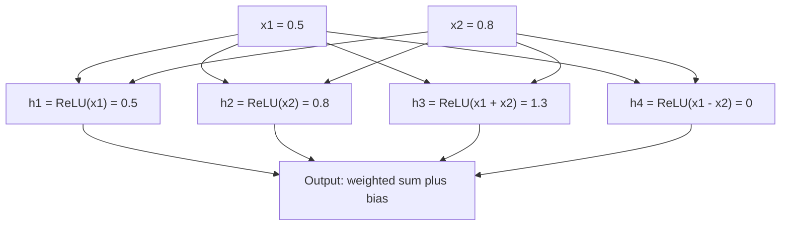
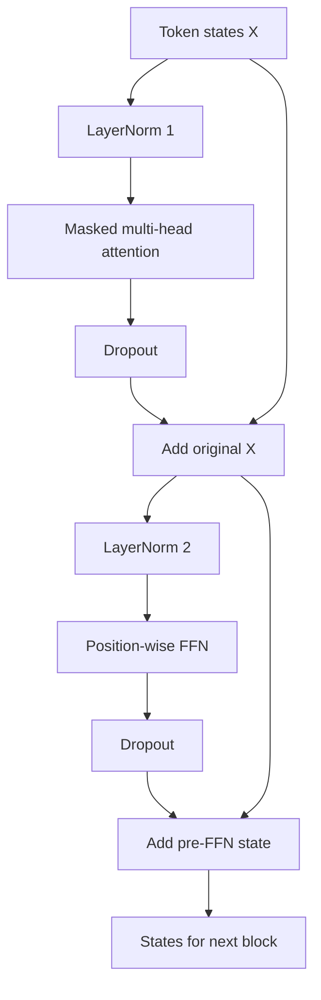
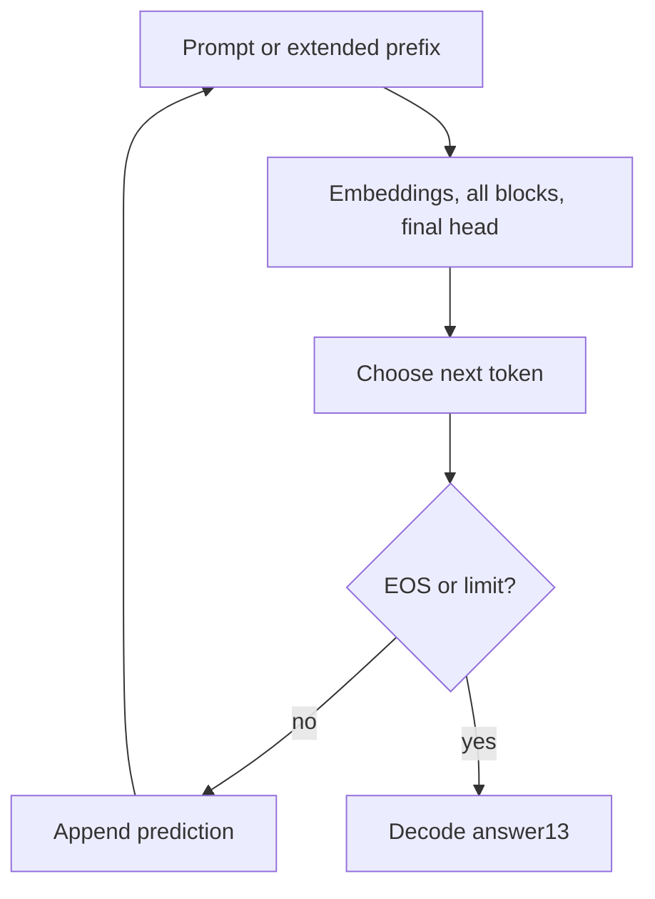
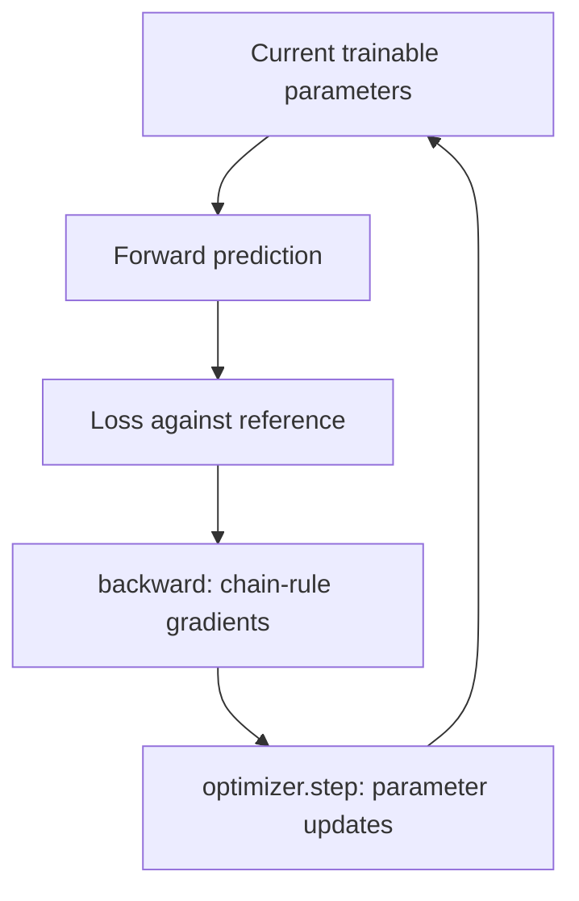
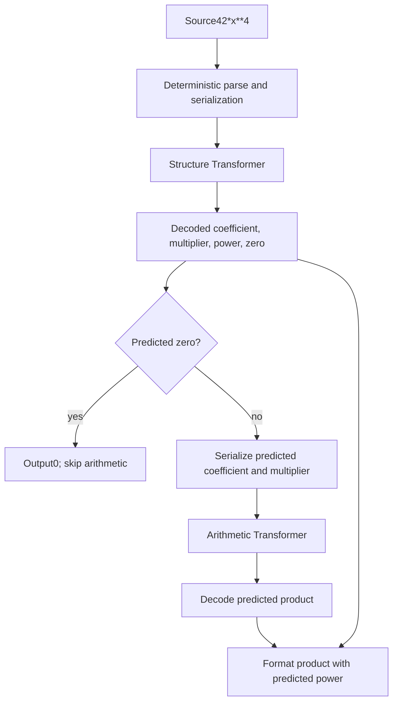
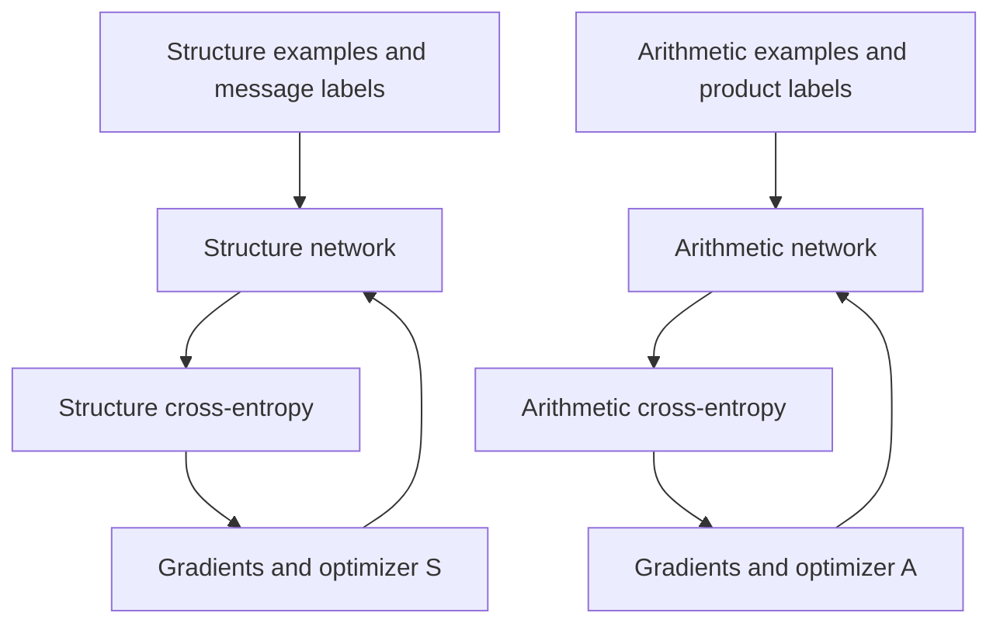

# Worked examples: 5 + 8 through an FFN and Transformer, then modular differentiation

This guide follows concrete data through forward computation, loss and parameter
updates. The numerical FFN and token-based Transformer examples for5+8 are
**teaching examples**, not measurements from trained checkpoints. The existing
architecture_comparison lab runs transpose, not addition. The modular section
maps to actual modular_math contracts and orchestration.

All vectors, weights, logits and attention values explicitly called illustrative
are chosen for explanation. They must not be mistaken for inspected activations
or evidence that a particular hidden layer learned a named mathematical step.

## 1. One task, two interfaces

We want5+8=13, but choose different representations:

| System | Input | Output | Training target |
|---|---|---|---|
| Numeric FFN | [0.5,0.8] | One real estimate, later multiplied by10 |1.3|
| Causal Transformer | BOS ADD 5 SEP 8 SEP | Digit tokens1,3 and EOS | [1,3,EOS] |

Scaling by10 is only for this example. The transpose comparison scales digits
by9. Numerical output versus token generation is an interface decision, not an
inherent restriction: an FFN can use embeddings and a Transformer can have a
numeric prediction head.

## 2. FFN input: the vector already contains the numbers

$$x=\begin{pmatrix}0.5\\0.8\end{pmatrix},\qquad y=1.3.$$

There is no embedding lookup here. Coordinate1 is the first operand and
coordinate2 is the second. An input layer is simply this interface; it need not
perform any transformation itself.

The following toy diagram has one hidden layer of four neurons. The actual
comparison FFN has two hidden layers and GELU; we use one layer and ReLU here
so every intermediate value is easy to calculate.



Arrows show possible dense connections. Some have weight0 in this engineered
example. Learned neural connectivity does not mean every weight must be nonzero.

## 3. FFN hidden layer: affine transformation and activation

Choose:

$$W=\begin{pmatrix}1&0\\0&1\\1&1\\1&-1\end{pmatrix},\quad b=0.$$

Then:

$$z=Wx+b=\begin{pmatrix}0.5\\0.8\\1.3\\-0.3\end{pmatrix}.$$

Apply ReLU coordinate-wise:

$$h=\max(0,z)=\begin{pmatrix}0.5\\0.8\\1.3\\0\end{pmatrix}.$$

A hidden neuron computes a weighted combination, adds its bias, then applies the
activation. The four entries are learned features, not four output answers.
With the actual GELU activation the values would differ; it is not a hard
negative-value cutoff. With a second hidden layer the same pattern repeats:
new affine combinations of h followed by another activation.

## 4. FFN output layer

With output weights w=[0.4,0.4,0.6,0] and output bias0:

$$\hat y=w^Th=0.4(0.5)+0.4(0.8)+0.6(1.3)=1.3.$$

Undo scaling:10 times1.3=13. There is no output activation required for an
unconstrained scalar regression head.

The weights were chosen to demonstrate a possible representation. Training
does not tell neuron3 to add, and many different weight configurations could
fit the task. Addition itself needs no hidden layer: weights[1,1] already give
an exact linear mapping. We retain the hidden layer to illustrate the mechanics.

## 5. FFN backward pass with actual derivative numbers

Suppose the output weights instead are:

$$w=(0.4,0.4,34/65,0),\qquad b_{out}=0.$$

The same h now gives normalized prediction1.2, or raw answer12. Using half squared
error for simple derivatives:

$$L=\tfrac12(\hat y-y)^2=\tfrac12(1.2-1.3)^2=0.005.$$

The output derivative is:

$$\delta=\frac{\partial L}{\partial\hat y}=\hat y-y=-0.1.$$

For the last layer:

$$\frac{\partial L}{\partial w}=\delta h=(-0.05,-0.08,-0.13,0),\qquad
\frac{\partial L}{\partial b_{out}}=-0.1.$$

For ordinary SGD with learning rate0.01, output weight updates are:

$$\Delta w=(0.0005,0.0008,0.0013,0),\qquad\Delta b_{out}=0.001.$$

If only this last layer were changed, its prediction would increase by0.00358
normalized units. During actual full-network training the hidden weights also
change, so this is not the complete resulting prediction update.

The hidden-layer error follows the chain rule:

$$\delta_h=\delta w,\qquad
\delta_z=\delta_h\odot\mathbf1[z>0],$$
$$\frac{\partial L}{\partial W}=\delta_zx^T,\qquad
\frac{\partial L}{\partial b}=\delta_z.$$

For hidden neuron1, delta_z=-0.04, so its two input-weight derivatives are
[-0.02,-0.032]. Neuron4's ReLU input is negative, so its local activation
derivative is0 for this example. Other data can activate it.

A deeper FFN repeats this backpropagation through every affine layer and
activation. Our actual numeric comparison uses mean squared error, not half
squared error; that introduces the corresponding averaging/factor2. The
chain-rule mechanism is unchanged.

## 6. Transformer input: token IDs are not numerical values

Use the arithmetic lab's symbolic format:

```text
Prompt: BOS ADD 5 SEP 8 SEP
Target: 1 3 EOS
```

In that lab's vocabulary BOS=10, ADD=16, SEP=11 and EOS=12:

```python
prompt_ids = [10,16,5,11,8,11]
answer_ids = [1,3,12]
input_ids  = [10,16,5,11,8,11,1,3]
labels     = [-100,-100,-100,-100,-100,1,3,12]
```

IDs are vocabulary-specific. modular_math uses another vocabulary, where these
same integer IDs have different meanings. Never transfer ID interpretations
between labs without their vocabulary tables.

The target aligned with the final prompt SEP is the first answer digit1.
-100 excludes prompt predictions from the loss; it is not an input token.

| Input position | Available token at that position | Label |
|---:|---|---|
|0|BOS|ignored|
|1|ADD|ignored|
|2|5|ignored|
|3|SEP|ignored|
|4|8|ignored|
|5|SEP|1|
|6|1|3|
|7|3|EOS|

Training processes all eight positions together, but the causal mask prevents
reading positions to the right. Thus a position cannot inspect its own future
answer token just because that token is present elsewhere in the training tensor.

## 7. Token and position embeddings

`nn.Embedding(vocab,dim)` creates a trainable lookup table at initialization.
`self.token(ids)` performs the lookup during forward. With teaching widthD4:

```text
Token embedding for8:  [ 0.80, -0.40,  0.20, 0.00]
Position vector at4:   [ 0.05,  0.10, -0.10, 0.05]
Initial state:         [ 0.85, -0.30,  0.10, 0.05]
```

These numbers are invented. Their coordinates do not inherently mean magnitude,
units or carry. The six prompt tokens become a6×4 matrix. The real model usually
uses D64, producing6×64 states before any answer tokens are appended.

## 8. One pre-LN Transformer block, in execution order



### 8.1 LayerNorm1

For each position separately, normalize its D features, then apply learned scale
and offset:

$$\operatorname{LN}(x)=\gamma\odot\frac{x-\mu}{\sqrt{\sigma^2+\varepsilon}}+\beta.$$

For the illustrative state[0.85,-0.30,0.10,0.05], mean0.175 and variance0.175625.
Ignoring tiny epsilon, with gamma1/beta0 this gives approximately:

```text
[1.61,-1.13,-0.18,-0.30]
```

LayerNorm does not add5 and8. It controls feature statistics. It does not mix
examples in a batch, and normalizes all D features of a token before head splitting.

### 8.2 Q, K and V projections

`self.qkv = nn.Linear(D,3*D)` learns three affine projections at once. They produce
queries, keys and values. Our code splits each into H heads. For D64/H4,
head width is16. For our illustrative D4/H2, it is2.

| Tensor at prompt length6 | Shape, omitting batch |
|---|---|
| Input states |6×4|
| Combined QKV |6×12|
| Q, K or V per head |6×2|
| Scores per head |6×6|

A query describes what features a position seeks; keys allow matching positions;
values provide information to mix. These are analogies, not manually assigned
semantic fields.

### 8.3 Scores, causal mask and attention softmax

$$S=QK^T/\sqrt{d_k},\qquad A=\operatorname{softmax}(S+M).$$

M forbids future positions by adding negative infinity. For the last prompt SEP,
a single illustrative head might assign:

| Key position | BOS | ADD |5| SEP |8| SEP |
|---|---:|---:|---:|---:|---:|---:|
| Weight |0.02|0.18|0.30|0.03|0.42|0.05|

These weights are a separate illustrative example, not computed from the one
embedding vector above; reproducing them would also require all other states
and QKV parameters.

The output is a weighted sum of **value vectors**:

$$z_i=\sum_j A_{ij}v_j.$$

It is not0.30 times5 plus0.42 times8, and need not numerically equal13. Attention
moves useful features into the output position. Later nonlinear processing and
other blocks can use those features.

### 8.4 Merge heads and residual1

Concatenate all head outputs and apply the learned attention output projection.
Dropout randomly suppresses/scales some update features during training; it is
disabled for evaluation. Add the update to the original states:

$$U=X+\operatorname{Dropout}(\operatorname{Attention}(\operatorname{LN}_1(X))).$$

The old state survives as a direct path. This is a feature-space addition, not
the task's arithmetic addition of operands.

### 8.5 LayerNorm2, FFN and residual2

Normalize U, then apply the same position-wise FFN at every position:

$$f(u)=W_2\operatorname{GELU}(W_1u+b_1)+b_2.$$

Our real width is64→256→64. The FFN transforms channels within each position;
attention supplies information from other positions. The second residual is:

$$Y=U+\operatorname{Dropout}(f(\operatorname{LN}_2(U))).$$

The next block receives Y. Four/eight blocks repeat these operations with
independent weights. We do not prescribe one block for carry and one for sum.

## 9. Final head and token-by-token generation

After all blocks, final LayerNorm plus Linear(D,vocab) produce vocabulary logits.
At the final prompt position, illustrative logits might favor digit1. Greedy
selection chooses argmax without needing output softmax. Append1, run the model
again, choose3, then EOS.



Output-vocabulary softmax is different from attention softmax. One selects
probabilities across possible next symbols; the other mixes information across
allowed key positions. Our implementation recomputes the prefix without a KV
cache. A numeric output head could avoid token generation, but that would be
a different interface from the current arithmetic model.

## 10. Transformer backward pass

At training time the correct earlier answer tokens are supplied (teacher forcing).
The loss averages negative log probabilities of1,3,EOS at their target positions:

$$L=-\frac13\left(\ln p(1\mid P)+\ln p(3\mid P,1)+\ln p(EOS\mid P,1,3)\right).$$

For a single position before averaging:

$$\frac{\partial L}{\partial z_k}=p_k-\mathbf1[k=\text{correct token}].$$

If the model assigns probability0.4 to the correct token1, its logit gradient is
-0.6; increasing that logit would reduce this position's loss. Another token
with probability0.2 has gradient+0.2. Averaging and later chain-rule factors
scale these gradients in the actual batch.

The gradient propagates through the output head, final LayerNorm, all residual
branches, FFNs, attention mixing/softmax and QKV projections, then embeddings.
Through attention, an output error can influence several earlier token states.
Residual branches add gradient contributions; they do not make gradients bypass
all trainable sublayers. LayerNorm is differentiable too.

Attention weights A are intermediate activations, not optimizer parameters.
Their derivatives help compute gradients of the persistent QKV parameters.
Embedding table rows used in the forward pass receive gradient contributions;
there are no separate hand-written rules saying how digit5 must relate to digit8.

## 11. Same optimization framework in both cases



```python
optimizer.zero_grad(set_to_none=True)
prediction = model(inputs)
loss = objective(prediction, labels)
loss.backward()
torch.nn.utils.clip_grad_norm_(model.parameters(), 1.0)
optimizer.step()
```

This is schematic: our Transformer returns logits and attention maps, and its
CE ignores-100 labels. In the arithmetic/modular labs AdamW maintains running
first/second gradient moments to adapt parameter steps. The earlier numeric
SGD update illustrates the gradient direction, not AdamW's exact update.
Weight decay, if enabled, is an additional shrinkage term; the comparison lab
sets it to0 while modular training uses0.01.

`eval()` disables dropout, not autograd. `no_grad()` disables graph recording.
Inference normally uses both. The optimizer never sees mathematical rules; it
sees gradients of the supplied objective.

## 12. Modular math: explicit duties for two independent networks

Use the already observed example:

$$f(x)=42x^4,\qquad f'(x)=(42\cdot4)x^3=168x^3.$$

In modular_math, duties are assigned through **different datasets and a mandatory
message interface**, not by naming internal Transformer layers.



The initial parser validates the restricted monomial syntax and extracts a,n
for canonical serialization. This is not a learned general mathematical-language
parser. It does not differentiate the expression in the inference path.

### 12.1 Structure network's input

For42*x**4:

```text
BOS DIFF MUL NUM 4 2 END POW X NUM 4 END SEP
```

This is prefix notation for the source monomial,13 tokens. The structure network
runs its own embedding tables and full Transformer block stack, then generates:

```text
COEFF NUM 4 2 END
DEGREE NUM 4 END
POWER NUM 3 END
ZERO 0 EOS
```

Decode into:

```json
{
  "coefficient": 42,
  "multiplier": 4,
  "power": 3,
  "zero": false
}
```

`DEGREE` encodes the multiplier in the contract: original exponent4. `POWER`
encodes the output exponent3. The field is not the product168.
The network is trained to copy/select coefficient42, supply multiplier4,
predict power3 and identify nonzero derivative. No internal block is guaranteed
to perform exactly one of those duties.

### 12.2 What crosses the boundary

Only the **decoded predicted fields** cross the interface. The controller builds:

```text
BOS MUL NUM 4 2 END SEP NUM 4 END SEP
```

The arithmetic network receives the two predicted operands42 and4, as a new
11-token prompt. It does not receive the first network's hidden states,
attention maps, gradients or the original expression as fallback input.
It also has its own learned embeddings, even though both models share token names.

The power3 stays with the controller for final formatting. It is not needed to
compute42 times4, so it is not in the arithmetic prompt.

### 12.3 Arithmetic network and final assembly

The second network runs its own blocks, then generates:

```text
NUM 1 6 8 END EOS
```

The decoder obtains168. Code combines **predicted168** with **predicted power3**
to display168*x**3. Formatting is deterministic; multiplication is not secretly
recomputed to repair the learned coefficient. If a network predicts a wrong
number, the pipeline preserves it unless the response fails format validation.
A zero coefficient can be canonically formatted as0.

If the first network predicts `zero=true`, the controller emits0 without calling
arithmetic. This flag is itself a learned responsibility and can be wrong.

## 13. Where gradients go in modular training

The networks are trained in **separate runs**:

| Training run | Inputs/labels | Updated parameters | Unaffected parameters |
|---|---|---|---|
| structure | Source monomial → reference message | Structure embeddings, blocks and head | Entire arithmetic model |
| arithmetic | Operand pair → reference product | Arithmetic embeddings, blocks and head | Entire structure model |

For this example:

- Structure CE compares its predicted message tokens with coefficient42,
  multiplier4, power3 and zero0.
- Arithmetic CE compares its predicted product tokens with NUM1 6 8 END EOS.

Each loss uses teacher forcing and backpropagates through its own Transformer.
The other network is neither loaded nor updated by that training command.



The diagram shows two disconnected optimization graphs. At pipeline inference,
they are connected by decoded discrete messages, but no training/backward pass
runs there. Argmax/decoding does not provide ordinary differentiable end-to-end
routing. Our separate modular training does not attempt to backpropagate final
pipeline error across that boundary.

This differs from the later straight-through bottleneck experiment, which uses
a surrogate gradient across a discrete forward interface. It also differs from
intermediate_math, where a diagnostic head did not force downstream computation
to use its message. Here the message is obligatory input to network2.

## 14. Distinguish upstream and downstream failures

| Structure prediction | Arithmetic result on received input | Consequence |
|---|---|---|
|42,4,power3|168|Correct168*x**3|
|42,4,power3|158|Arithmetic error:158*x**3|
|42,3,power3|126|Arithmetic correct on its input; structure multiplier wrong|
|42,4,power4|168|Coefficient correct; structure output power wrong|
|zero=true|Skipped|Wrong0 for this source|

The third case is why module accuracy on its actual received input differs from
whole-pipeline accuracy. The second module cannot infer the lost original4 from
a prompt containing42 and3 alone.

For constants, a wrongly copied coefficient can be mathematically irrelevant if
the zero flag correctly bypasses arithmetic. Therefore exact message accuracy
and final derivative accuracy are separate metrics.

In our reports:

| Field | Interpretation |
|---|---|
| structure_contract_correct | All predicted message fields match their reference |
| structure_with_exact_arithmetic_correct | Would this predicted message yield the correct derivative with a perfect multiplier? |
| arithmetic_on_received_input_correct | Was the generated product correct for the operands actually passed? |
| correct | Is the final pipeline derivative correct? |

The exact-arithmetic field is a **diagnostic counterfactual**, not a replacement
for the generated product. References are introduced after inference in score().

## 15. Reading the real code

| Location | Responsibility |
|---|---|
| modular_math/contracts.py | Vocabulary, serialization, message grammar and parsers |
| modular_math/model.py | Same embeddings/attention/FFN/norm architecture within each module |
| modular_math/train_module.py | Train one selected role using its own dataset and optimizer |
| modular_math/pipeline.py: forward | Pass only predicted message values; zero branch; assemble output |
| modular_math/pipeline.py: score | Add references and diagnose errors after inference |

Existing inference command, if these checkpoints are present:

```bash
cd ~/python_workspace/transformer-demo/modular_math
python3 run_pipeline.py \
  --structure runs/structure --arithmetic runs/arithmetic-depth8 \
  --expr '42*x**4'
```

This guide does not change code/checkpoints or launch retraining. The structure
and arithmetic depths can differ (for example4 and8 blocks). Depth is configured
per network; division of duties comes from their tasks and interface, not depth.

## 16. Three different kinds of intermediate representation

| Design | Intermediate object | Is downstream forced to use it? | Training route |
|---|---|---|---|
| Ordinary hidden layers | Learned vectors without prescribed meanings | Later layers use their vectors | End-to-end differentiable |
| Generated scratchpad | Observable products/sums as tokens | Later generated tokens can attend to them; correctness not enforced | Teacher-forced next-token training |
| modular_math | Typed predicted message between networks | Yes; no hidden-state bypass | Separate supervised module training |

A scratchpad makes steps observable but does not prove the model internally
executes them faithfully. A module boundary enforces what information is
available downstream but does not guarantee that the information is correct.
Both are useful tools for learning and diagnosis, with different guarantees.
