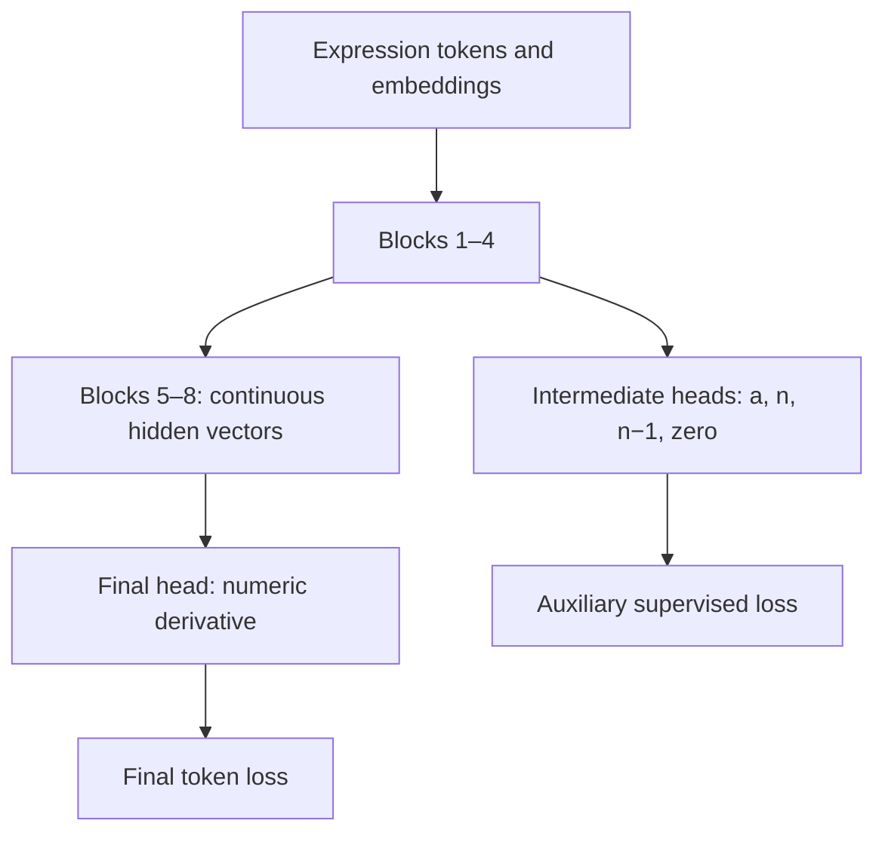

# Intermediate supervision inside ONE Transformer

This architectural experiment compares a plain final-answer objective with an
additional supervised head attached inside the same eight-block stack. It is a
new lab beside modular_math/, arithmetic/ and symbolic_diff/; previous runs are
untouched. It reads the existing modular_math pipeline splits without changing
them. No regeneration of source functions is needed.

## Architecture



This is NOT the previous discrete module pipeline. Intermediate decoded numbers
are diagnostic outputs; they are not parsed and re-encoded for blocks 5–8.
Those blocks receive the full continuous residual stream at every position.
There is no mathematical guarantee that the last four blocks perform only
multiplication. The auxiliary task encourages useful features in the first four
blocks while allowing final loss to optimize the entire network.

## 1. Install and check

Extract intermediate_math/ into the repository root. With the shared environment:

```bash
cd ~/python_workspace/transformer-demo
source .venv/bin/activate
cd intermediate_math
python3 -m pip install -r requirements.txt
python3 -m unittest discover -s tests -v
```

Source data defaults to ../modular_math/data/pipeline/{train,validation,test}.jsonl.
If modular_math data was moved elsewhere, pass --data to the directory for train.py
or to a particular file for evaluate.py. The loader constructs its own final
labels and intermediate fields in memory. The files are read only. Training
reads train and validation only; evaluation reads the file explicitly selected.

## 2. Controlled pair of runs

```bash
# Control: no intermediate training signal.
python3 train.py --aux-weight 0 --out runs/final-only

# Experiment: same network, initialization, data order and optimizer settings;
# one additional loss term.
python3 train.py --aux-weight 1 --out runs/intermediate-supervised
```

Defaults: 8 blocks, intermediate boundary after block 4, D=64, heads=4,
FFN width=256, context=128, AdamW lr=0.001, batch=64, seed=42, max epochs=100,
min epochs=20, patience=8, min_delta=0.001. Exact generation during epoch monitoring
uses a fixed 64-record validation prefix by default; --exact-samples 0 uses all.
All validation records contribute to final loss and auxiliary field metrics.

Both runs instantiate the identical architecture (including auxiliary heads), so
parameter initialization and the data loader RNG are aligned. With weight 0 the
auxiliary heads receive no training gradients and their accuracy is not meaningful.
They do not feed the final branch. Weight 1 trains both tasks. Each run starts
from scratch, not from the previous modular checkpoints. Early stopping selects
minimum validation FINAL loss, so the comparison does not favor the combined
objective simply because it has another term.

The extra branch adds 4028 parameters to an otherwise 411417-parameter 8-block
trunk/head at D=64, V=25, context=128: total 415445. No computation/parameter
matching against the two-model system is claimed. The two runs above are the
controlled comparison of auxiliary supervision.

Changing --aux-layer or --aux-weight is a separate experiment. Use new output
folders; nonempty run folders are rejected. Model weights are saved in model.pt,
best-loss.pt, best-exact.pt, last.pt; settings, hashes, metrics and selected epoch
are saved too. Resume/fine-tuning and automatic plotting are not implemented.

## 3. What exactly is supervised?

For 42*x**4, the original prompt uses the same canonical monomial grammar as
modular_math. The intermediate head reads the hidden vector at the final prompt
SEP position, AFTER block 4. Seven categorical outputs predict:

| Slot | Classes | Correct target |
|---|---:|---:|
| Sign of original coefficient | 2 | positive |
| Coefficient magnitude: hundreds digit | 10 | 0 |
| Coefficient magnitude: tens digit | 10 | 4 |
| Coefficient magnitude: units digit | 10 | 2 |
| Original degree / multiplier n | 13 | 4 |
| New power max(0,n-1) | 13 | 3 |
| Derivative-is-zero flag | 2 | false |

These are parallel classification heads, NOT autoregressive message generation.
They decode to an inspectable message {coefficient:42,multiplier:4,power:3,zero:false}.
Coefficient magnitude supports 0..999, exponent classes 0..12. Leading coefficient
zeros are a fixed-width label convention. Zero's sign is canonically positive.
Strict intermediate accuracy requires every categorical slot to be correct.

The final decoder emits numeric coefficient and power:

```text
NUM 1 6 8 END SEP NUM 3 END EOS
```

Both values are generated by the network. Host code only parses/normalizes zero
and formats the expression; it does not multiply a*n to supply the output.
References compute a*n only to make training labels or score completed predictions.
Final answer generation sees original input plus its own previous output tokens.
It never receives gold intermediate fields at inference.

Teacher-forced final-answer tokens appear after the prompt during training, but
the causal mask means the auxiliary prompt position cannot attend to them. The
intermediate label is supervision, not an extra input embedding. Tests explicitly
change future answer tokens and check auxiliary logits stay unchanged.

## 4. Loss and gradient routing

```text
L_final = mean token cross entropy over final answer + EOS
L_aux   = mean of the seven intermediate categorical cross entropies
L_total = L_final + aux_weight * L_aux
```

The mean over seven heads prevents an automatic factor of seven in the auxiliary
loss. aux_weight=1 still does not mean identical gradient magnitudes: objectives
have different geometry/scales. It is an experimental starting point, not a
universal optimal balance.

| Objective | Embeddings / blocks 1–4 | Blocks 5–8 | Intermediate heads | Final head |
|---|---|---|---|---|
| Final only | Updated | Updated | No gradient | Updated |
| Auxiliary only | Updated | No gradient | Updated | No gradient |
| Combined | Updated by both | Updated by final | Updated by auxiliary | Updated by final |

Inspect these actual gradients without modifying weights:

```bash
python3 gradient_probe.py
# Or inspect a trained model:
python3 gradient_probe.py --run runs/intermediate-supervised
```

The probe makes three separate backward passes on the same batch with dropout
turned off, prints gradient norms by parameter group, and performs NO optimizer
steps. auxiliary_only should show zero norm in late_blocks and final_head;
final_only should show zero norm in intermediate_heads. Combined norms are not
necessarily the sum of norms because gradients are vectors that can reinforce
or oppose one another.

## 5. Compare complete validation, then select a run

```bash
python3 evaluate.py runs/final-only \
  --data ../modular_math/data/pipeline/validation.jsonl
python3 evaluate.py runs/intermediate-supervised \
  --data ../modular_math/data/pipeline/validation.jsonl
```

Both evaluate the whole file, saving metrics.json, predictions.jsonl and
errors.jsonl under each run's evaluation-validation/. Main measures:

- final_loss and token_accuracy: teacher-forced final prediction;
- exact_match: full generated coefficient/power token sequence, including EOS;
- mathematical_accuracy: evaluated coefficient/power, normalizing zero;
- intermediate_contract_accuracy: all seven intermediate categorical slots;
- intermediate_field_accuracy: each slot separately.

The baseline's random intermediate head can show arbitrary accuracy; do not
interpret it as a measurement of all information present in its hidden state.
Likewise a correct trained intermediate message does not guarantee the final
answer uses it. The final branch can still compute redundantly or ignore some
features. Establishing causal use would require controlled interventions.

Inspect both outputs for one expression:

```bash
python3 inspect_model.py runs/intermediate-supervised --expr '42*x**4'
python3 inspect_model.py runs/intermediate-supervised --expr=-2*x**3
```

After selecting a run with validation, evaluate test:

```bash
python3 evaluate.py runs/intermediate-supervised \
  --data ../modular_math/data/pipeline/test.jsonl
```

Use the selected run name, not automatically the auxiliary-supervised one.
Improvement is a hypothesis. Several seeds would be needed for stronger claims.
Since the existing test data has already informed earlier design choices, treat
it as development diagnostics if making broader scientific claims.

## 6. What this experiment can teach

If intermediate supervision helps final accuracy, explicit structural labels
provided a useful learning signal within a continuous shared representation.
If intermediate accuracy is high but final arithmetic remains weak, an accurate
side task is insufficient to solve multiplication. If final accuracy drops, task
competition or loss weighting may be factors, but they require further tests.
No outcome alone proves a specific block has acquired a unique mathematical role.

Old modular_math checkpoints are incompatible with this model despite the shared
vocabulary. This lab adds branch weights and a different final sequence contract.
Previous experiments remain unchanged. In contrast to two independent modules,
you cannot swap just 'the multiplier checkpoint' here: the stack is jointly trained.

## Verification

Two data/contract tests passed and the existing 2389 source functions were audited
for target construction and split preservation. All Python files compiled. Three
PyTorch tests are included for gradient routing, future-answer non-leakage,
a combined optimizer update and checkpoint reload. They are SKIPPED in the
delivery environment because PyTorch is unavailable; full training/inference
was not run here. Run the tests in the project's existing .venv before training.
