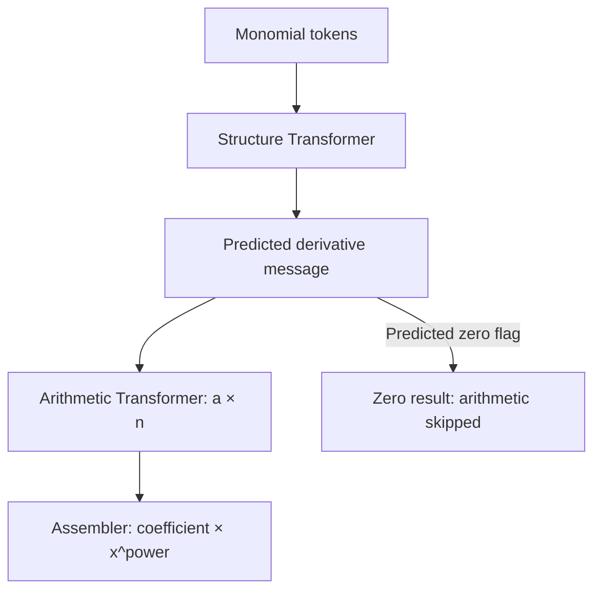

# Modular mathematics: two independently trained Transformers

This lab demonstrates independent supervised training, a typed discrete
intermediate interface, and diagnosis of errors in a composed neural system.
It is deliberately separate from arithmetic/ and symbolic_diff/.

The source is a monomial a*x**n. The first model emits a derivative message;
the second predicts a*n; a deterministic assembler builds the final expression.
Both neural models are causal decoder Transformers, each with its own weights,
optimizer, training run and checkpoints. The structure model never supplies the
correct intermediate value to the arithmetic model during pipeline inference.



A model learns responsibilities through intermediate labels and explicit
interfaces, not through a comment naming a Transformer block 'multiply'. Each
module can contain multiple blocks. This lab does not implement end-to-end
backpropagation across discrete generated messages.

## 1. Install and generate data

Extract modular_math/ beside arithmetic/ and symbolic_diff/. Use the shared root
virtual environment:

```bash
cd ~/python_workspace/transformer-demo
source .venv/bin/activate
cd modular_math
python3 -m pip install -r requirements.txt
python3 -m unittest discover -s tests -v
python3 prepare_data.py
```

Defaults: coefficients -199..199, powers 0..5, seed 42. Zero appears only as the
zero constant. The full finite space contains 2389 monomials. Absolute coefficient
and exponent pairs are grouped together with sign variants and swapped operand
orders when both are in the domain; group splits are 70/15/15, with remainder in
train. This prevents direct held-out multiplication pairs from leaking across
module splits. Equal products from different pairs are not excluded.

For the default seed this gives 1679 train, 356 validation and 354 test examples
PER ROLE. Membership and source functions are aligned between roles, but prompts
and labels differ and files are stored separately:

| Dataset | Input | Supervised output |
|---|---|---|
| data/structure/*.jsonl | Prefix monomial | Coefficient, multiplier, new power, zero flag |
| data/arithmetic/*.jsonl | Signed coefficient and multiplier | Integer product |
| data/pipeline/*.jsonl | Monomial parameters | Reference only for post-inference scoring |

prepare_data.py refuses to overwrite a nonempty output directory. Use --out and
--seed for another experiment. It saves capacities, counts, token vocabulary and
per-role dataset hashes in dataset-config.json. These are fresh splits, so the
percentages from the older symbolic_diff experiments are not directly comparable.

## 2. Train each component independently

```bash
python3 train_module.py --role structure --out runs/structure
python3 train_module.py --role arithmetic --out runs/arithmetic
```

Run these sequentially on a laptop to avoid CPU/memory contention. The arithmetic
command does not load, modify or require the structure checkpoint. The reverse
is also true. Training does not read test files or pipeline reference files.

Defaults: 4 blocks PER MODULE, D=64, heads=4, FFN=256, context=128, batch=64,
AdamW lr=0.001, dropout=0.1, max epochs=100, min epochs=20, patience=8,
min_delta=0.001. Both modules together have eight blocks, but this is NOT an
ordinary eight-block Transformer: a decoded message separates the networks.
Module depths can differ. For example, keep structure small and test a deeper
arithmetic component in a separate run:

```bash
python3 train_module.py --role arithmetic --layers 8 --dim 64 --heads 4 \
  --lr 0.0003 --out runs/arithmetic-8layers
```

Do not assume this will help; compare validation before deciding. Do not change
several settings simultaneously when trying to attribute an improvement.

Each epoch updates only the chosen network. Validation loss/token accuracy use
all validation labels; free-generation exact uses the fixed first 64 shuffled
validation records by default. Use --exact-samples 0 for all records (more CPU
cost). --monitor val_loss is the default, with --monitor exact available.
Stop on patience after min-epochs and restore the selected best checkpoint.

Saved artifacts: metrics.csv, config.json, summary.json, best-loss.pt,
best-exact.pt, last.pt and model.pt. Each checkpoint embeds the vocabulary,
role and architecture. A run directory must be empty. Training starts from
scratch; optimizer-state resume/fine-tuning is not implemented in this lab.
No plots are generated automatically in this first modular experiment.

## 3. Inspect the actual live boundary

```bash
python3 run_pipeline.py --structure runs/structure --arithmetic runs/arithmetic \
  --expr '42*x**4'
python3 run_pipeline.py --structure runs/structure --arithmetic runs/arithmetic \
  --expr=-2*x**3
python3 run_pipeline.py --structure runs/structure --arithmetic runs/arithmetic \
  --expr '7'
```

Only monomials/constants are accepted, using the bounded parser: x, -x, a*x,
a*x**n, or an integer constant. |a|<=999, n<=12 for manual inspection; values
beyond the training range are extrapolation tests, not expected guaranteed cases.
There is no eval() of user input.

A successful trace for 42*x**4 should contain:

1. Structure prompt and generated tokens.
2. Decoded message `{coefficient:42, multiplier:4, power:3, zero:false}`.
3. Arithmetic received_operands `[42,4]` and its generated numeric answer.
4. Final coefficient, power and expression, e.g. 168*x**3.
5. Reference-based diagnostics computed AFTER the forward pass.

If structure emits 41 and 3, arithmetic receives 41 and 3. There is no fallback
to the original 42 and 4. If either stage generates invalid syntax or fails to
emit EOS within 48 tokens/context, the chain records a stage-specific error.
A predicted zero flag bypasses arithmetic. An incorrectly predicted zero flag
therefore counts as a structure/pipeline error; it is not repaired by the host.

## 4. Evaluate modules separately, then together

Start with validation:

```bash
python3 evaluate_module.py runs/structure --data data/structure/validation.jsonl
python3 evaluate_module.py runs/arithmetic --data data/arithmetic/validation.jsonl
python3 run_pipeline.py --structure runs/structure --arithmetic runs/arithmetic \
  --data data/pipeline/validation.jsonl --out runs/pipeline-validation
```

The standalone evaluations give each module its own ground-truth INPUT, as in
its individual supervised task. Pipeline evaluation feeds the second module the
first module's PREDICTION. Those are different diagnostic conditions.

| Pipeline metric | Meaning |
|---|---|
| correct | End-to-end mathematical accuracy |
| structure_contract_correct | All predicted message fields exactly match labels |
| structure_with_exact_arithmetic_correct | Diagnostic: would exact multiplication of the predicted message yield the correct derivative? |
| arithmetic_on_received_input_accuracy | Product accuracy conditional on the inputs actually sent to arithmetic; invalid numeric output counts wrong |
| arithmetic_calls | Denominator for the previous metric; excludes bypassed constants and malformed first-stage outputs |
| invalid_structure / invalid_arithmetic | Stage-specific syntax/generation failures |
| by_input_degree | End-to-end correct counts by original exponent |

The exact-arithmetic diagnostic is computed only in score(), after the real
pipeline output exists. It does NOT replace the second neural module in inference.
A compensating pair of errors can yield a correct final answer with an incorrect
intermediate contract; reporting both makes this visible. Error rates do not
necessarily multiply because errors and input distributions are dependent.

Full reports: metrics.json, predictions.jsonl (including every message) and, for
the pipeline, errors.jsonl. --out controls pipeline report location; commands
may overwrite an existing report directory. It is separate from model weights.

After choosing settings on validation, test the modules and pipeline:

```bash
python3 evaluate_module.py runs/structure --data data/structure/test.jsonl
python3 evaluate_module.py runs/arithmetic --data data/arithmetic/test.jsonl
python3 run_pipeline.py --structure runs/structure --arithmetic runs/arithmetic \
  --data data/pipeline/test.jsonl --out runs/pipeline-test
```

## 5. Why there is no gradient across the boundary

The structure network is trained on its own complete message using teacher forcing
and token cross entropy. Arithmetic is trained independently on integer pairs.
At inference, both run in eval mode without gradients. Argmax generation and the
integer parser are discrete operations: ordinary backpropagation cannot flow
through this pipeline into the first network. The composition stage changes no
weights. This explicit separation is the purpose of this experiment.

To study joint training later, one could pass continuous hidden features or add
intermediate heads and losses to a shared network. That changes the interface and
its guarantees. This lab is not mixture-of-experts routing, and it does not assign
operations to individual attention heads or anonymous blocks.

## 6. Vocabulary and compatibility

The new lab owns a 25-token vocabulary with DIFFERENT IDs from symbolic_diff.
Its structure fields include COEFF, DEGREE, POWER, ZERO. Never copy old model.pt
into these runs: weights are trained from scratch and checkpoints validate roles
and the vocabulary. Existing arithmetic/symbolic_diff runs are untouched.
The Transformer implementation is copied locally for a self-contained lab; no
cross-folder sys.path manipulation or accidental imports are required.

The final assembler normalizes zero to (0,0). For constants, 'power=0' is an output
convention, not a statement that the zero polynomial has a uniquely defined degree.
Numerical references are deterministic labels; their availability to the evaluator
does not mean they are available to the neural forward pass.

## 7. What to learn from the experiment

- Can the structure module learn its contract independently of multiplication?
- Is arithmetic wrong on correct operand pairs, or are its inputs already wrong?
- Does increasing only arithmetic depth/width change the limiting component?
- Does standalone module accuracy survive composition with predicted inputs?
- What information is lost or made explicit at a typed boundary?

High accuracy on this bounded monomial domain is not a universal differentiator.
The arithmetic output is bounded by its training distribution, and manual inputs
outside it need independent checks. Training arithmetic on the held-out pairs
would invalidate the pipeline's held-out estimate. New data must respect the
shared cross-module split policy.

See [ARCHITECTURE.md](ARCHITECTURE.md) for tensor sizes and message encoding,
and [VERIFICATION.md](VERIFICATION.md) for tests and execution limitations.
