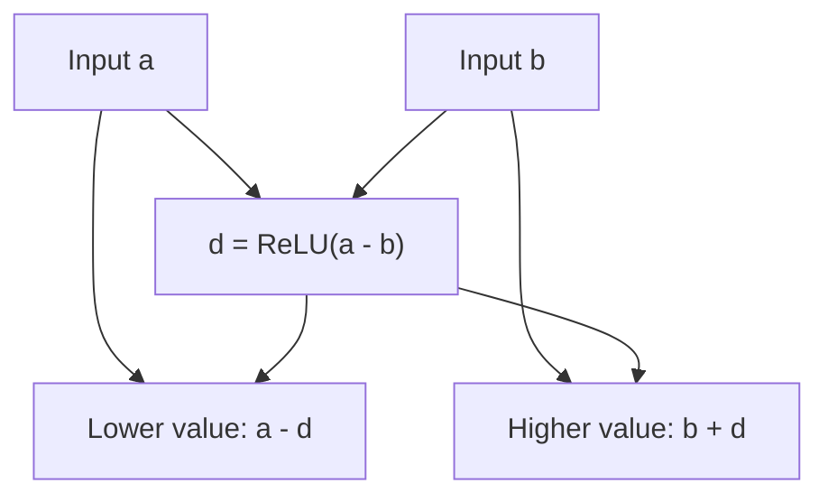

# Sorting after transpose: why the problem changes

## 1. Fixed routing versus value-dependent routing

Fixed3×3 transpose has one input-to-output permutation for every matrix.
Fixed-length reversal also has one fixed permutation. Sorting does not:

| Input | Ascending output | Required action |
|---|---|---|
| [2,7] | [2,7] | Keep order |
| [7,2] | [2,7] | Exchange values |
| [2,2] | [2,2] | Keep duplicate count |

Sorting may be written y=P(x)x, but its routing permutation depends on the
values. With duplicate values several source-index permutations can give the
same value output. We score value sequences, not an arbitrarily chosen identity
for equal items; stable identity tracking is not part of this task.

## 2. Why a single affine layer is a useful negative control

For two real inputs, the first sorted output is min(a,b). Suppose it could be
represented exactly as alpha*a+beta*b+c everywhere. Values at(0,0),(0,1),(1,0)
force c=beta=alpha=0, but then(1,1) incorrectly gives0 rather than1.
Thus one affine map cannot implement exact min on all such inputs, and cannot
implement general exact sorting. Multiple linear layers without activations
still collapse to an affine map.

The experiment decodes numeric outputs by rounding; that is itself a nonlinear
decoding step. The exact-affine proof is not a theorem about every possible
finite-domain accuracy after rounding. Nevertheless a globally affine estimate
is a restrictive hypothesis class for sorting the full digit domain. Its
measured results must be reported, not replaced by the theoretical expectation.

A linear regression model can learn output order-statistic averages or other
compromises. Those may look ordered while changing the particular input values.
A low MSE or high ordered-rate alone does not establish correct sorting.

## 3. Nonlinearity can express comparison

For two scalars, an exact ReLU comparator can be written:

$$d=\operatorname{ReLU}(a-b),\qquad \min(a,b)=a-d,\qquad \max(a,b)=b+d.$$

Composing comparison operations gives sorting networks for fixed sizes. This
explains why nonlinear networks have suitable expressive capacity. Our actual
FFN uses GELU and generic dense layers: we do not wire or initialize explicit
comparators and do not claim it discovers this specific algorithm.

## 4. Transformer attention is also value-dependent

For a token sequence, attention builds queries/keys from current representations,
computes similarities and mixes value vectors. Its routing can depend on which
digits are present. Position-wise FFNs transform those mixed features, and later
blocks refine them. A causal output position can attend to all input digits
because they appear before the answer in the prompt.

This gives a possible mechanism for conditional information selection. It does
not guarantee accurate comparisons, counts of duplicates, or an algorithm that
generalizes to arbitrary lengths. Standard soft attention is not automatically
an exact min operation, nor a hard pointer constrained to copy one input token.

At generation, a Transformer must also keep track of values already emitted.
It can repeat or omit a value even while producing a perfectly formatted answer.
The numeric FFN instead emits all output coordinates in one pass. These are
important interface differences, not evidence about attention alone.

## 5. A six-value worked example

Input:

$$x=[3,1,4,1,5,9].$$

Correct value output:

$$[1,1,3,4,5,9].$$

The two ones must both survive. Merely eliminating duplicates would give the
wrong length and wrong multiplicities. We sort by numeric digit magnitude, not
by token-ID magnitude. Our digit IDs happen to be in order, but that does not
turn token embeddings into numerical values.

For the numerical FFN:

- input is[3/9,1/9,4/9,1/9,5/9,9/9];
- hidden features depend on all coordinates and GELU nonlinearities;
- six raw estimates are decoded independently by scaling/rounding;
- we do not sort these predictions afterward.

For the Transformer:

- serialize operation, length, input digits and separator;
- embed tokens and positions;
- apply the same pre-LN attention/FFN/residual stack studied earlier;
- generate LEN D6 DATA followed by six digits, END and EOS;
- compare the generated digits with the exact reference.

No hidden block has an assigned “smallest value”, “next-smallest value” or
“duplicate counter” responsibility. Explicit modular sorting would be another
architectural experiment, not a description of this implementation.

## 6. Two independent correctness requirements

| Candidate for [3,1,4,1,5,9] | Ordered? | Same multiset? | Correct? |
|---|---|---|---|
| [1,1,3,4,5,9] | Yes | Yes | Yes |
| [1,2,3,4,5,6] | Yes | No | No |
| [3,1,4,1,5,9] | No | Yes | No |
| [1,3,4,5,9] | Wrong length | No | No |

For a correct-length valid value sequence, nondecreasing order plus identical
multiset is sufficient for a correct ascending sort. Aggregate ordered-rate
and preserved-rate describe different failure modes; inspect their per-example
intersection, not just each rate independently.

A wrong-length or invalid output is scored as zero correct aligned positions
under our policy. A position accuracy of0 therefore need not mean that every
individual emitted digit was numerically wrong.

## 7. Why group by multiset

[3,1,4,1,5,9] and[9,5,1,4,1,3] have the same sorted answer. If one is in training
and the other in test, success might reflect familiarity with that bag, even
though the input order is new. We therefore keep the entire bag in one split.

For n values from an alphabet of size10, the number of multisets is:

$$N=\binom{10+n-1}{n}.$$

At n6:

$$N=\binom{15}{6}=5005.$$

A particular bag with multiplicities c1,...,c10 has:

$$\frac{6!}{\prod_i c_i!}$$

distinct input permutations. For[3,1,4,1,5,9], there are6!/2!=360. For six equal
values there is only1. The generator takes up to2 permutations per selected bag
by default. All duplicates in labels are retained.

This grouped split tests held-out bags within the same length/digit domain.
It does not test arbitrary-length algorithmic sorting or prove a model knows
the abstract sorting rule. It is also not an IID digit distribution: uniformly
sampled bags differ from uniformly sampled ordered sequences.

## 8. Fair conclusions

Compare exact sequence accuracy, position accuracy, ordered-rate, preservation,
parameters and runtime on identical data. A larger FFN controls parameter budget
approximately; it does not control FLOPs, activations or number of output steps.
Numeric MSE and token CE have different units and should not be directly ranked.

Use several initialization seeds before claiming modest architectural benefits.
Fixed-length FFN input/output sizes make this a bounded comparison. We deliberately
reject evaluation on another length for every model in this stage, rather than
silently giving only one family a different task. Variable-length and
same-token-interface experiments can be added later if this comparison is useful.

A practical known sorting task should use a deterministic sorting algorithm;
this experiment examines neural representation and learning, not a proposed
replacement for Python sorted or an optimized sorting implementation.
