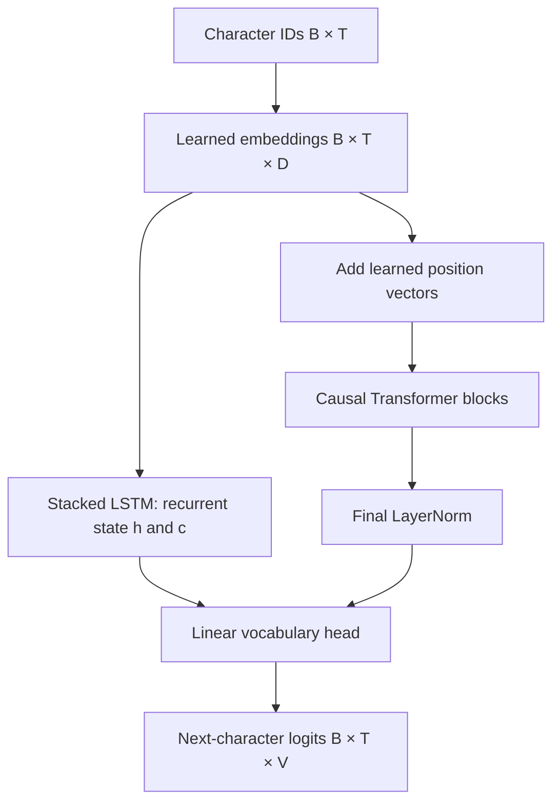
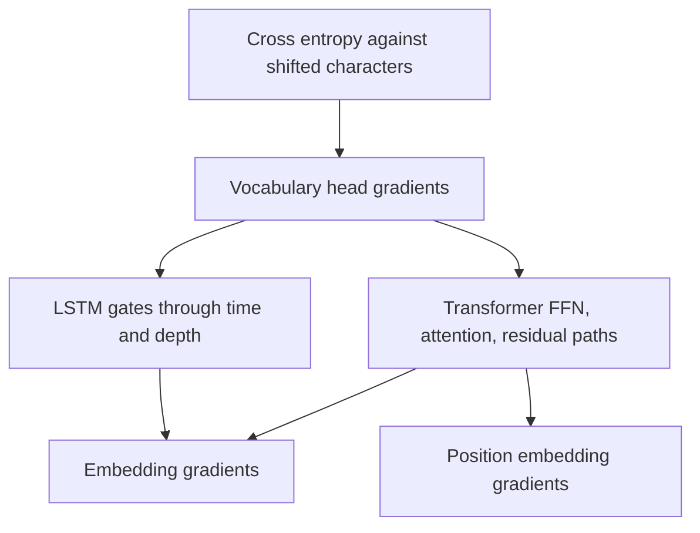

# LSTM versus causal Transformer

Both models receive integer character IDs `[B,T]`, learn embeddings `[V,D]`,
produce logits `[B,T,V]`, and minimize the same next-character cross entropy.
An embedding row is a learned parameter, not a handcrafted description of a letter.
These token embeddings are not ready-made sentence vectors for semantic search.

## LSTM: carry a state along the sequence

At each character t the LSTM combines its embedding with the preceding hidden
state h_(t-1). Input, forget and output gates control what enters, remains in and
is exposed from a cell state c_t. The cell is a learned continuous memory, not a
text buffer. Stacked layers receive the lower layer's sequence of hidden vectors.
The vocabulary head converts the top hidden vector to next-character scores.

A future character cannot change an earlier hidden state. Within a training block
backpropagation follows the recurrent computations through time and through
stacked layers. It updates gates, projections, embeddings and the head. There is
no gradient across independently sampled blocks because we reset state.

Defaults are a 64-dimensional embedding and two 128-wide recurrent layers.
Here 128 is the hidden/cell width per layer; gates internally use several
projections. It is not 128 total parameters or a count of independent classifiers.

## Transformer: read earlier positions with attention

The embedding is added to a learned position vector. Each pre-LN block contains:

1. LayerNorm across the D features of each position.
2. Q/K/V projections and four attention heads. Scores depend on token content;
   a causal mask forbids access to future characters.
3. Attention output projection, dropout and a residual addition.
4. Another LayerNorm, then FFN: D → 4D → D with GELU.
5. Dropout and a second residual addition.

Final normalization and a linear vocabulary head produce logits. At D=64 each
head has Q/K/V width 16; the block FFN expands to 256 features. Two blocks repeat
this computation with separate learned weights. Blocks are not assigned spelling,
grammar or story-planning duties. Any such specialization must be measured.

Attention mixes information ACROSS positions; the FFN transforms features AT EACH
position, with shared weights. During training all positions are processed in
parallel under the mask. Generation remains sequential: choose a character,
append it, then predict again. We use the transparent Q/K/V implementation from
our earlier comparisons rather than a hidden nn.Transformer wrapper.

## Same objective, different paths for gradients

`loss.backward()` computes chain-rule derivatives. Clipping limits the combined
gradient norm to 1; AdamW updates parameters with adaptive moments and weight
decay. Sampling/argmax is not in the training path. No gradient flows through a
generated story. We train with known previous characters, then separately inspect
free-running continuations.

For a fair bounded-context baseline generation recomputes only the last 64 IDs
for both models and resets the LSTM state. A production LSTM can carry state and
a Transformer can use a KV cache, but their efficient implementations are a
separate experiment. Current speed is not an architectural lower bound.
